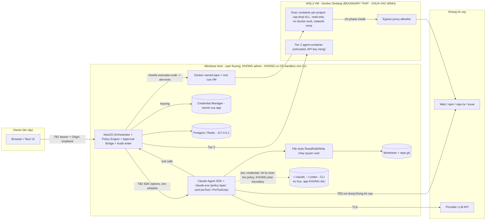

# PHASE_0_SECURITY_SIGNOFF_CHECKLIST.md — AI WORKSPACE

> Vai trò: Security Reviewer (không phải tác giả của bộ tài liệu bảo mật gốc) · Ngày: 2026-10-30 · Phạm vi: chỉ tài liệu, Phase 0 · Phase 1 chưa bắt đầu.
> **Trạng thái tài liệu này: DRAFT — NOT APPROVED.** Reviewer không phê duyệt, không đánh dấu APPROVED, không tick ô ký nào. Mọi cột "Owner sign-off" để trống cho Owner.
> Nhãn bằng chứng dùng trong file này:
> - **Đã xác minh (lệnh)** = Reviewer tự chạy lệnh read-only trên máy này ngày 2026-10-30 (mục 4).
> - **Đã xác minh (doc)** = một tài liệu nguồn nêu kết quả kiểm chứng/trích docs chính thức; Reviewer chưa tái hiện. Chỉ dùng khi doc nguồn thực sự ghi nhận.
> - **Giả định** = chưa có lệnh hay evidence. **Gap** = thiết kế thiếu hoặc mâu thuẫn. **Reviewer đề xuất** = ý kiến của Reviewer, chưa ai duyệt.
> Không đọc file credential, không chạy Docker container, không chạy prompt model, không cài phần mềm.

---

## 1. Mô hình bảo mật đề xuất (một trang)

### 1.1 Nguyên tắc
1. Trên Windows native, **permission + hook của CLI chỉ là policy layer, không phải security boundary** (Đã xác minh (doc): SECURITY §0, §2.2; SANDBOX_DESIGN §6 L-01; D-007; trích docs chính thức Claude Code "Native Windows is not supported... runs commands unsandboxed").
2. **Boundary thật duy nhất** là container trong VM WSL2 của Docker Desktop (TB4). Hiện **chưa xác minh được**: daemon không chạy (Đã xác minh (lệnh), mục 4).
3. **CLI sở hữu credential của nó**; app không đọc `~/.claude/.credentials.json`, `~/.codex/auth.json` (D-008; Đã xác minh (doc): CREDENTIAL_MANAGEMENT §3–4). Secret khác của app nằm ở Windows Credential Manager.
4. Mọi hành động có rủi ro đi qua **một policy engine** (deny > ask > rewrite > allow, fail-closed) và **audit ghi intent trước khi trả quyết định** (PERMISSION_MODEL §6.1; AUDIT_LOGGING §5.1). Đây là thiết kế, chưa có code.
5. **Con người duyệt mọi merge vào protected branch và mọi prod deploy**; Lead agent chỉ đề xuất (THREAT_MODEL TM-E-05; D-009).

### 1.2 Sơ đồ ranh giới (Mermaid)

Chú giải: mũi tên chấm = đường mà policy cố chặn nhưng **không có boundary kỹ thuật** (R1/R2). Vùng HOST không có sandbox OS: một lệnh/đường dẫn lọt policy chạy với toàn quyền user trên `C:\` và `D:\`.

### 1.3 Ai chạy ở đâu, ai sở hữu gì

| Thành phần | Chạy ở | Sở hữu credential | Ghi chú / nhãn |
|---|---|---|---|
| NestJS backend, policy engine, audit writer, Postgres, Redis | Host (backend native); DB/Redis trong Docker, publish `127.0.0.1` | Secret app: Credential Manager (`@napi-rs/keyring`, chưa thử trên Node 24 — Giả định) | INFRASTRUCTURE §4.1, §5 |
| Claude Code (SDK in-process, D-004) / CLI | **Host**, user thường | **CLI/Anthropic login của Owner** (OAuth `claude.ai`, `subscriptionType: team` — Đã xác minh (lệnh)) | Mọi agent Tier 1 dùng chung một login (R2/R4) |
| File tools (Read/Edit/Write) | Host, quyền user | — | Chặn bằng deny rule + path check (logical) |
| Build/test/run/install code sinh ra | **Docker container** (rewrite `aiw-exec`) | Không có credential | SANDBOX §4; **chưa test** |
| Tier 2 (project untrusted) | Container hoàn toàn | `ANTHROPIC_API_KEY` riêng, file tmpfs, **tốn API credits** | SANDBOX §5; cần Owner duyệt chi phí |
| Codex | Host (`codex app-server`) | CLI Codex/OpenAI login | **CLI chưa cài** (Đã xác minh (lệnh)); toàn bộ là Giả định |
| UI token, hook token | Memory + (đề xuất gốc) file `%LOCALAPPDATA%\aiw\run\server.json` | Backend | Xem G-09: token trên đĩa là lỗ hổng thiết kế |

### 1.4 Policy layer của CLI trên Windows: enforce được / không enforce được

| Cơ chế | Enforce được | KHÔNG enforce được | Bằng chứng |
|---|---|---|---|
| `permissions.deny Bash(rm *)` | Lệnh viết đúng dạng, kể cả sau `&&`/pipe | `/bin/rm`, `bash -c`, `node -e`, script tự xoá | Đã xác minh (doc): SECURITY §2.2 trích docs permissions; chưa tái hiện |
| `Read/Edit` deny | File tools, `cat/head/sed/tee`, redirect CLI nhận dạng | Chương trình tự mở file bằng path tuyệt đối; `PowerShell Get-Content` map không đầy đủ | Đã xác minh (doc): SECURITY §2.2, SANDBOX L-03 |
| `blockReadsOutsideWorkingDirectories` | File tools ngoài cwd | Subprocess | Đã xác minh (doc) trích docs; chưa test |
| PreToolUse hook (deny/`updatedInput`) | Thấy `tool_input.command` trước khi chạy | Không chạy nếu `--bare`/`disableAllHooks`/lỗi settings; không thấy MCP/LSP trên host | Đã xác minh (doc): SECURITY §2.2; hành vi exit 2 / `updatedInput` trong `-p` trên 2.1.312 **chưa test** (PERMISSION_MODEL §14.1) |
| `canUseTool` (SDK) | Chặn được `Write` khi callback trả deny | — | Đã xác minh (doc): research/CLAUDE_CODE_INTEGRATION.md dòng 21, 418–423 (một probe `sdkprobe`, chạy 1 lần); Reviewer chưa tái hiện |
| Hook `type: http` (SECURITY §2.3) | — | Chưa có bằng chứng chạy thật trên Windows | Gap: QA_REVIEW_PHASE0 §5 mục 1, P1-05 |
| `sandbox.enabled` | — | **Không trên native Windows** (chỉ WSL2) | Đã xác minh (doc): SECURITY §2.2 |
| Settings người dùng | — | `~/.claude/settings.json` có `skipDangerousModePermissionPrompt: true` và khối `autoMode` | **Đã xác minh (lệnh)**: grep tên khoá, mục 4 |
| Phiên bản CLI | — | `claude --version` = 2.1.312 | **Đã xác minh (lệnh)** |

### 1.5 Đề xuất bổ sung của Reviewer (chưa ai duyệt, khác hoặc chặt hơn docs gốc)
- **RV-1 Host-exec tối thiểu**: Tier 1 mặc định **tắt Bash/PowerShell trên host** (`disallowedTools`), mọi lệnh đi qua một tool do app cung cấp (`aiw-exec`); chỉ danh sách đọc-only theo **argument-level allowlist** mới chạy host (xem G-11). Thu hẹp R1 từ "mọi thứ qua denylist regex" xuống "bề mặt nhỏ, định nghĩa được". Chưa kiểm chứng khả thi với SDK.
- **RV-2 Project untrusted/clone từ nguồn lạ ⇒ Tier 2 hoặc không cho chạy** (không phải "tuỳ chọn").
- **RV-3 Không nạp settings người dùng/project vào agent**: `settingSources: []` + `settings` tường minh (G-06/G-07), sau khi kiểm chứng login vẫn hoạt động (CF-047).
- **RV-4 Không lưu token UI/hook trên đĩa** (G-09).
- **RV-5 Gate theo thứ tự**: không chạy agent có tool nào trước khi M0 tối thiểu (SECURITY §11) có test xanh; roadmap hiện để security ở Phase 4, sau khi agent live ở Phase 2 (G-01b).
- **RV-6 Git do orchestrator chạy phải "hardened"** (G-10).

---

## 2. Checklist ký duyệt

Cột "Design status": **Specified** / **Partially specified** / **Gap**. "Verification": **Not tested** hoặc **Tested with evidence path**. Hiện **không có hạng mục nào được kiểm thử bằng code** (chưa có code). Cột "Owner sign-off" cố ý để trống: `[ ]`.

| # | Hạng mục | Requirement | Design reference (doc:section) | Design status | Verification | Residual risk | Owner sign-off |
|---|---|---|---|---|---|---|---|
| 1 | Host/sandbox boundary | Code do agent sinh ra (build/test/run/install) không chạy trên host; host CLI chỉ là policy layer; khi Docker down ⇒ `executes-code` bị deny (fail-closed) | SECURITY §0, §2.3, §9 (fail-closed); SANDBOX_DESIGN §3–4, §6, §9; D-007; CF-016, CF-053 | **Partially specified** — còn: warm vs ephemeral chưa ADR (G-03), host-truth vs volume-truth chưa chốt, Bash host vẫn tồn tại (G-11) | **Not tested** — daemon không chạy (Đã xác minh (lệnh)); SB-00..SB-17 chưa chạy; chưa có `VERIFICATION_LOG.md` | **High** (R1, R5) | `[ ]` |
| 2 | Filesystem permissions | Agent chỉ ghi trong `writable` của manifest; không đọc cred/`.ssh`/`.aws`/`.env`/worktree khác; chặn UNC, junction/reparse, 8.3, ADS | SECURITY §3.4, §6.2; PERMISSION_MODEL §5, §7; SANDBOX L-06, L-07; THREAT_MODEL TM-T-03, TM-I-01, AB-06; WORKSPACE §6–7 | **Partially specified** — enforce host là logical; manifest/settings/hook nằm trong worktree ở WORKSPACE §4, §7.1 (mâu thuẫn, G-06); TOCTOU check→ghi còn mở | **Not tested** (SB-12, SB-13, SB-14, PM-05/06) | **High** (R1, R4) | `[ ]` |
| 3 | Command execution permissions | Denylist/ask/allow/rewrite theo engine; normalizer; interpreter-by-default vào container; hook lỗi ⇒ deny | SECURITY §3, §5; PERMISSION_MODEL §5, §6, §9; SANDBOX §4.7; PROVIDER §7, §17; CF-013, CF-014 | **Partially specified** — cơ chế hook vs `canUseTool` chưa chốt (G-01); PowerShell/cmd/`wsl`/`docker` thiếu trong phân loại, host_safe allowlist theo tên lệnh (G-11); denylist `git config` chỉ `--global` (G-10) | **Not tested** — chỉ có 1 probe `canUseTool` deny Write (doc-reported); CP corpus ≥ 300 chưa có | **High** (R1, R8) | `[ ]` |
| 4 | Network permissions | Host Bash không network; WebFetch allowlist; container `--network none`, chỉ install qua proxy allowlist; không IP literal/RFC1918 | SECURITY §2.3(7), §3.1; SANDBOX §4.4; PERMISSION_MODEL §5 `network`; THREAT_MODEL TM-I-03; INFRASTRUCTURE §6.6 | **Partially specified** — không có kiểm soát egress kỹ thuật cho tiến trình CLI/host (chỉ denylist tên lệnh); proxy ≠ firewall, domain fronting (R6); file tools/MCP vẫn có mạng | **Not tested** (EG-01..03) | **Med–High** (R6) | `[ ]` |
| 5 | OAuth/session credentials | App không đọc/copy cred CLI; chỉ `claude auth status`; env whitelist; không `ANTHROPIC_API_KEY` ở Tier 1; không mount `~/.claude` vào container | D-008; SECURITY §4; CREDENTIAL_MANAGEMENT §3, §4, §6, §9; PROVIDER §18; ADR-0008 | **Specified** nhưng còn mâu thuẫn: INFRASTRUCTURE §4.2 (`claude-home` volume), WORKSPACE §7.2 (mount `~/.claude` ro) trái D-008 (G-12); env whitelist thiếu/dư `APPDATA/LOCALAPPDATA` (G-08) | **Not tested** (không có test "không có code đọc cred"; Semgrep chưa có). Một phần: `claude auth status` chạy được, `loggedIn: true` (Đã xác minh (lệnh)) | **High** (R2) | `[ ]` |
| 6 | Prompt injection | Nội dung ngoài là untrusted; chặn **hành động** không chặn "lời"; taint flag; human review mọi merge protected | THREAT_MODEL §3.4 PI-01..PI-10; SECURITY §10 R3; PERMISSION_MODEL §6.1(b), §14.6; PROJECT_RISKS R-PROMPT-INJ | **Partially specified** — delimiter/taint chỉ "Đề xuất", chưa spec ảnh hưởng quyết định; corpus ≥ 50 mẫu chưa tồn tại; `merge_main` có thể cấu hình tắt (G-04) | **Not tested** | **High** (R3, không loại bỏ được) | `[ ]` |
| 7 | Agent-to-agent communication | Mọi message liên agent là untrusted; chỉ orchestrator chuyển thư; không message nào đổi owner/approve; artifact ref không thoát project root | AGENT_COLLABORATION §3–4, §8, §13; THREAT_MODEL PI-09, PI-10, TM-E-05, AB-01..AB-12 | **Gap** (phần bảo mật) — AGENT_COLLABORATION không có: gói payload trong `<untrusted>`, redaction, giới hạn kích thước; MCP `aiw.send_message` xung đột `--strict-mcp-config`/deny `mcp__*`; `agent_memory` được inject vào prompt không qua duyệt (G-13) | **Not tested** | **Med–High** | `[ ]` |
| 8 | Git worktree isolation | 1 task = 1 worktree = 1 branch; manifest ngoài worktree; Lớp 3 `validateDiff` là cổng quyết định; không tự merge `main`; git của orchestrator không thực thi mã do agent kiểm soát | D-009; WORKSPACE_AND_GIT_ISOLATION §4–9; SECURITY §6; PERMISSION_MODEL §7; ADR-0009; CF-032, CF-046 | **Partially specified** — layout/tên/author lệch (G-17, G-18); `repo.git` dùng chung, hook/config git do agent ghi có thể chạy trên host khi orchestrator `git merge` (G-10); `acceptEdits` + settings trong worktree (G-06) | **Not tested** (GIT-01..03, SB-13) | **High** (R4) | `[ ]` |
| 9 | Audit log | Append-only, hash chain từ M0, intent trước/outcome sau, spool khi DB down, fail-closed cho hành động rủi ro cao, anchor ngoài DB | AUDIT_LOGGING §3–§8, §11 AU-01..16; SECURITY §8; CF-005, CF-006, CF-051; D-008 | **Specified** (chi tiết tốt) — còn đóng lệch: tên bảng, retention 180/365, hash chain tuỳ chọn trong DEVSECOPS, kênh anchor chưa chọn (G-15) | **Not tested** | **Med** (R-A1: superuser DB + HMAC cùng user OS) | `[ ]` |
| 10 | Human approval | Approval bind `input_hash`; fail-closed khi timeout; không auto-approve; Lead không duyệt thay human; rate-limit chống approval fatigue; danh tính người duyệt đáng tin | SECURITY §5; PERMISSION_MODEL §3, §6, §8; PROVIDER §17; CF-007, CF-017, CF-048; D-003, D-004 | **Partially specified** — 5 giá trị timeout (G-02); POL-11/12 tuỳ chọn vs rule R030 (G-04); single-user: quyền duyệt = bearer token đọc được bởi tiến trình cùng user (G-09) | **Tested with evidence path (một phần, doc-reported)**: `canUseTool` chặn Write — `docs/research/CLAUDE_CODE_INTEGRATION.md` dòng 418–423; Reviewer chưa tái hiện; luồng Approval Center **Not tested** | **High** (R1 ⇒ tự duyệt) | `[ ]` |
| 11 | Emergency stop | STOP ALL không qua hook/CLI; Job Object kill cả cây + container; < 5 s; ghi audit; resume chỉ Owner | SANDBOX_DESIGN §7–8; SECURITY §3.5; PROVIDER §16; THREAT_MODEL AB-12 | **Partially specified** — Job Object giả định app tự spawn CLI, nhưng D-004 dùng SDK tự spawn `claude.exe` (G-20); `aiw-job.exe` vs `koffi` chưa chốt; lệnh `docker kill $(...)` cú pháp bash, cần bản PowerShell | **Not tested** (SB-15, CH-05) | **Med–High** | `[ ]` |
| 12 | Docker socket exposure | Agent/container không có docker.sock/named pipe; không `docker` từ agent; spec container deny-by-default (`assertSafeSpec` + inspect trước mỗi exec) | SANDBOX §4.1–4.3, §9, SB-06/07; SECURITY §2.3(5), §3.1 "Docker escape"; INFRASTRUCTURE §6.8, §4.2; PERMISSION_MODEL §4.3 (12) | **Partially specified** — named pipe là root-VM và user host luôn truy cập được (không thể khoá kỹ thuật, R5); denylist docker chỉ bắt vài cờ, không bắt `-v C:\...:/x`, `--mount`; không nhắc `wsl.exe -d docker-desktop`, podman/nerdctl (G-11) | **Not tested** — daemon down (Đã xác minh (lệnh)); `docker inspect` chưa chạy | **High** (R5) | `[ ]` |
| 13 | Secrets in logs/events | Một `Redactor` cho 5 điểm; corpus 200 × 6 encoding = 0 leak; env whitelist; không secret trong DB/FE/audit | CREDENTIAL_MANAGEMENT §8, §10; SECURITY §4.4; AUDIT_LOGGING §9; THREAT_MODEL TM-I-02, TM-I-05 | **Specified** — chưa kiểm: transcript CLI trên host ngoài redaction (R9); `input_hash` SHA-256 trần brute-force được với lệnh ngắn (đã nêu đề xuất HMAC) | **Not tested** (RD-corpus, AU-06) | **Med** (R9) | `[ ]` |
| 14 | Localhost API auth | Bind 127.0.0.1; bearer 32 byte per-launch; Origin allowlist; WS auth; hook listener tách port; không token trong query; Postgres/Redis không dùng mật khẩu mặc định | SECURITY §7; THREAT_MODEL TM-S-01, TB1, TB7; INFRASTRUCTURE §5; CF-041 | **Partially specified** — MVP là web + Vite (D-001) nhưng Origin allowlist chỉ có `tauri://`; cách đưa token vào browser chưa định nghĩa; token ghi `server.json` (G-09); compose có `POSTGRES_PASSWORD:-aiw_dev_only`, Redis không mật khẩu (G-14); roadmap để API auth ở P4-10 trong khi API/WS dựng ở Phase 1 (G-01b) | **Not tested** (API-01..05) | **Med–High** | `[ ]` |

**Khối ký cuối (để trống):**
- Owner đã đọc mục 3 (gap), mục 5 (residual risk): `[ ]`
- Owner chấp nhận từng residual ACCEPTABLE_IF_OWNER_ACKNOWLEDGES đã liệt kê (ghi ngày, điều kiện): `[ ]`
- Mọi NOT_ACCEPTABLE_UNTIL_MITIGATED đã có bằng chứng đóng: `[ ]`
- Chữ ký / ngày Owner: ______________

---

## 3. Inconsistency và gap ảnh hưởng an toàn

Mỗi mục có đề xuất xử lý cụ thể. **Đây là đề xuất của Reviewer; chưa được duyệt; Reviewer không tự áp dụng.** Cột "Chặn" = mốc đầu tiên bị chặn nếu không giải quyết: **P1** (Phase 1 contract freeze/DB/compose/API), **P2-live** (lần đầu agent thật có tool), **P4**.

| ID | Gap / mâu thuẫn | Bằng chứng (doc:section) | Ảnh hưởng an toàn | Đề xuất xử lý cụ thể | Chặn |
|---|---|---|---|---|---|
| G-01 | **Cơ chế approval**: SECURITY §2.3/§5 thiết kế HTTP PreToolUse hook cho `claude -p` (listener `127.0.0.1`, `AIW_HOOK_TOKEN`, `--settings`) vs D-004 SDK `canUseTool` + hook in-process (PROVIDER §7, §17, §25 #1, CF-013, QA P1-05) | SECURITY.md §5.1/§5.3; PROVIDER_INTEGRATION §17; QA_REVIEW §5 mục 1 | Hai bề mặt tấn công khác nhau; HTTP hook chưa chạy thử trên Windows; test "verify `SessionStart` hook" (L-04/R8) chỉ áp cho CLI. Hàng PROVIDER §7 ghi `settings:{disableAllHooks:true}` cùng hàng với `settingSources` — nếu hiểu theo nghĩa đen sẽ tắt luôn hook policy | (a) Chốt SDK in-process hai tầng (PreToolUse = policy cứng, `canUseTool` = hỏi người, cùng một engine). (b) Bỏ hook listener + `AIW_HOOK_TOKEN` khỏi MVP; HTTP hook chỉ cho CLI fallback sau PoC. (c) Làm rõ dòng `disableAllHooks` (ý định là chặn hook của settings/repo, không phải hook SDK). (d) Gate P2-live: PoC trên SDK 0.3.314 + Windows chứng minh: deny Write ngoài worktree, `updatedInput` rewrite Bash, hook lỗi ⇒ deny; lưu evidence vào `VERIFICATION_LOG.md` | P2-live |
| G-01b | **Thứ tự roadmap vs M0**: SECURITY §11 yêu cầu M0 (admin guard, settings generator, denylist, redaction, token/Origin, audit) **trước khi có agent thật chạy**; roadmap đặt agent live ở Phase 2 (P2-01, chat P2-05), policy/hook/token/audit ở Phase 4 (P4-02..P4-10) | IMPLEMENTATION_ROADMAP §3.7 vs §3.9; SECURITY §11 | Agent chạy host với toàn quyền user trong Phase 2–3 mà chưa có policy; API/WS ở Phase 1 chưa có auth | Kéo vào Phase 1/đầu Phase 2 (gate P2-live): P4-03 (denylist+normalizer), P4-10 (token/Origin/admin guard), `canUseTool` deny-by-default, audit tối thiểu, redaction (P2-03). Phase 2 chỉ chạy agent với **tool tắt/đọc-only trong thư mục hy sinh** tới khi M0 xanh | P1 (API auth), P2-live |
| G-02 | **Timeout approval** 5+ giá trị: 540 s (SECURITY §5.3), 3600 s (DB `timeout_sec`), 10 phút (PROVIDER §17), 30 phút (research), 24 h/không giới hạn (RESOURCE, BA); approval pending được "kích hoạt lại" khi duyệt muộn (PERMISSION_MODEL §6.4); `WAITING_APPROVAL` chiếm slot hay không (CF-048) | SECURITY §5.3; PERMISSION_MODEL §6.4; PROVIDER §17; CF-007, CF-048 | Duyệt muộn rồi chạy lại lệnh cũ trên cây file đã đổi; hook/approval treo chiếm slot; xung đột thiết kế dẫn tới fail-open nếu implement sai | Một quy tắc ghi DECISION_LOG: tool-level 10 phút ⇒ deny + task `WAITING_HUMAN`; **không bao giờ approve khi timeout**; kích hoạt lại phải sinh approval **mới** bind `input_hash` + `manifestHash` + HEAD commit; hết hạn tối đa 24 h với class rủi ro (prod/merge/data), `scope=once`, ttl ≤ 15 phút; cột DB khớp (`input_hash`, `source`, `risk_tags`) trước freeze P1-04 | P1 (schema) |
| G-03 | **Container warm vs ephemeral**: SECURITY §2.3(5) 1 container sống lâu/project; INFRASTRUCTURE §6.1 ephemeral/job; SANDBOX §3 đề xuất lai | CF-016; SANDBOX §3, §14 mục 3 | Container warm dùng chung cho mọi agent của project: nhiễm từ lần install/test này sang agent khác; state tồn đọng | ADR: ephemeral cho project `untrusted`, preview, custom Dockerfile và **sau mọi `install`**; warm chỉ cho trusted với recreate 4 h/đổi trust; mỗi agent exec với cwd/thư mục riêng và `.tmp` riêng, không chia sẻ cache ghi được giữa agent (AB-05) | P4 |
| G-04 | **POL-11/POL-12 tuỳ chọn vs rule R030/R050 bắt buộc**; cột "Có tắt được?" của R030 chỉ cấm tắt `prod_deploy`, nghĩa là `merge_main`/`data_deletion` có thể tắt | PERMISSION_MODEL §9; CF-017; USER_ROLES POL-11/12 | Nếu `merge_main` tắt được, điều kiện chấp nhận R3 ("human review mọi merge vào protected branch") không còn đảm bảo | Đặt `merge_main`, `prod_deploy`, `data_deletion`, `credential_access`, `self_modify` là **immutable** (không tắt qua UI/DB, chỉ qua config commit + restart); POL-11 chỉ áp cho `integration/*`; POL-12 mặc định `ask` cho untrusted, `allow+audit` cho trusted kèm `--ignore-scripts`; Lead agent không có quyền approve | P1 (seed policy) |
| G-05 | **Khuyến nghị `.wslconfig memory=12GB, processors=6` "máy 32 GB"** vs máy thực 15.77 GB, free 4.18 GB; không có `.wslconfig` | INFRASTRUCTURE §6.5, §12; QA P1-12; **Đã xác minh (lệnh)** mục 4 | Làm theo khuyến nghị chiếm ~76% RAM ⇒ host hết RAM, orchestrator/hook timeout, emergency stop chậm (DoS tự gây). Tổng giới hạn container (3 × 4g = 12g) > VM hợp lý | Tham số hoá theo RAM: máy 16 GB ⇒ `memory=6GB` (tối đa 8), `swap=0`, `processors=4`; tổng `--memory` các container ≤ VM − 1 GB; mặc định sandbox concurrency 1–2 tới khi có số đo; ghi vào ENVIRONMENT_SETUP. **Không sửa `.wslconfig` khi chưa có Owner đồng ý** | P4 |
| G-06 | **Vị trí settings/hook/manifest**: WORKSPACE §4, §7.1 đặt `.claude/settings.json`, `.ai-workspace/hooks/*.mjs`, `manifest.json` trong worktree, spawn `acceptEdits`, hook `command`; SECURITY/PERMISSION đặt ngoài worktree, `--settings`, `manual`; PROVIDER: `default` + whitelist (CF-014, CF-046) | WORKSPACE §7.1; SECURITY §2.3; PERMISSION_MODEL §7.1; PROVIDER §7 | File policy trong worktree do agent ghi được nếu deny lọt (WORKSPACE tự ghi tiền sử deny-rule bug #6699); repo lạ có `.claude/settings.json`/`.mcp.json` có thể nạp hook/MCP chạy trên host | Theo CF-014/046: không file policy trong worktree; policy/manifest ngoài worktree, hash lưu audit; `permissionMode: default` + whitelist; `strictMcpConfig: true`; deny `Edit(.claude/**)`, `Edit(.aiw/**)` làm lớp phụ; sửa WORKSPACE §4/§7.1/§9 | P2-live |
| G-07 | **`settingSources: ['user']`** (PROVIDER §7) nạp `~/.claude/settings.json` có `skipDangerousModePermissionPrompt: true` và `autoMode` | PROVIDER §7; SANDBOX L-10; **Đã xác minh (lệnh)** (khoá tồn tại, mục 4); `~/.codex/config.toml` có `[windows] sandbox = "elevated"` | Cấu hình cá nhân của Owner có thể nới prompt/quyền cho agent của app | Dùng `settingSources: []` + `settings` tường minh do app sinh; PoC xác nhận login OAuth vẫn hoạt động (CF-047); snapshot test "không có `bypassPermissions`, không `skipDangerous...`"; Codex: config do app sinh, không kế thừa, không trust `d:\code\tuyen` | P2-live |
| G-08 | **Env whitelist**: SECURITY §4.1 thiếu `APPDATA/LOCALAPPDATA`; PROVIDER/CREDENTIAL §6.1 có; thêm `LOCALAPPDATA` đồng nghĩa agent biết đường tới `%LOCALAPPDATA%\aiw\run\`, `audit\spool`, `policy` | CF-047; SECURITY §4.1, §7; CREDENTIAL §6.1 | Thư mục điều khiển của app nằm trong profile, cùng user ⇒ ACL "chỉ user" không chặn được agent đã thoát policy | Giữ `APPDATA/LOCALAPPDATA` (OAuth cần) nhưng **không đặt token/khoá/policy có hiệu lực quyết định trong profile**: token không ghi đĩa (G-09), tính toàn vẹn policy/audit dựa DB role + hash chain + anchor, không dựa ACL file | P2-live |
| G-09 | **Quyền duyệt lấy được bởi tiến trình cùng user**: UI token ghi `server.json` (SECURITY §7) trong khi cùng doc nói Tauri nhận qua `invoke`; MVP là web (D-001) với Origin allowlist chỉ `tauri://`; single-user "người duyệt = bearer + Origin" (PERMISSION_MODEL §3) | SECURITY §7; PERMISSION_MODEL §3; THREAT_MODEL TM-S-01 | Agent đã lọt R1 đọc `server.json` ⇒ tự gọi API approve mọi thứ, vô hiệu hoá toàn bộ human gate | Không ghi token ra đĩa; cấp token qua kênh một lần (URL fragment/handoff in-memory khi launch hoặc Tauri `invoke`); thêm Origin cho web dev/prod cụ thể; class `merge_main/prod_deploy/data_deletion` cần xác nhận lại trong UI bằng **nonce chỉ hiển thị trong UI** (không có trong API đọc được); chấp nhận phần còn lại thuộc R1 | P1 |
| G-10 | **Git do orchestrator chạy trên repo agent ghi được**: denylist chỉ chặn `git config --global`; `git config core.fsmonitor/core.hooksPath/diff.external/filter.*`, `.git/hooks` dùng chung `repo.git`, `-c` inline đều thực thi chương trình khi `git status/merge/commit` chạy trên host | SECURITY §3.1 "Git destructive", §6.3(8) merge ở host; WORKSPACE §9, §10 (`extensions.worktreeConfig`) | Agent (hoặc nội dung repo untrusted) biến thao tác git của orchestrator thành thực thi mã trên host với quyền user, **ngoài tầm hook** | **Reviewer đề xuất (chưa kiểm chứng):** chạy git của orchestrator với `-c core.hooksPath=NUL -c core.fsmonitor=false -c core.pager=cat -c protocol.ext.allow=never`, `GIT_CONFIG_GLOBAL/SYSTEM` cố định, `GIT_EXTERNAL_DIFF` rỗng; merge thực hiện trên bare repo/clone riêng agent không ghi; deny mọi `git config` (mọi scope) và `git -c`; kiểm tra `config`/`hooks` hash trước mỗi thao tác host; `validateDiff` chạy trong container | P2-live |
| G-11 | **Phân loại lệnh host thiếu**: `executes_code` không có `powershell/pwsh/cmd/wsl/bash.exe`; `docker` chỉ bị bắt vài cờ; không có `wsl.exe -d docker-desktop` (distro `docker-desktop` tồn tại — Đã xác minh (lệnh)), `podman/nerdctl/docker.exe`; allowlist host_safe theo **tên lệnh** (`find`, `rg`, `cat`, `cp`, `mv`) cho phép `find -exec/-delete`, `rg --pre <cmd>`, `git diff --ext-diff`/`--output` | SECURITY §3.1, §3.3; PERMISSION_MODEL §5 `commands.classes`; SANDBOX §4.7(5) | Lệnh "an toàn" thực thi chương trình tuỳ ý hoặc vào VM Docker với quyền root, vượt denylist | Thêm PowerShell/pwsh/cmd/wsl/bash/`*.exe` bất kỳ ngoài allowlist vào `dangerous` hoặc rewrite container; deny `wsl*`, `docker*`, `podman*`, `nerdctl*` sau normalize (cả `node -e` nằm trong container nên không chạm named pipe); host_safe chuyển sang **argument-level allowlist** (cờ cho phép từng lệnh) hoặc RV-1 (tắt host Bash) | P2-live |
| G-12 | **Điều khoản trái D-008 trong tài liệu hạ tầng**: staging dùng volume `claude-home` đã `claude login` trong container `worker`; WORKSPACE §7.2 "mount `~/.claude` read-only" cho hardened mode; DEPLOYMENT.md §4 | INFRASTRUCTURE §4.2; WORKSPACE §7.2; SANDBOX §5 (cấm); CREDENTIAL §3 | Implementer làm theo doc sai sẽ đưa OAuth vào container chạy code không tin cậy | Đánh dấu hai đoạn là **ngoài MVP / bị thay thế**; sửa theo SANDBOX §5 (Tier 2 = API key riêng); thêm test "không mount home/.claude" (SB-07) vào gate | P1 (doc) |
| G-13 | **Agent-to-agent**: không có quy tắc untrusted/redaction/kích thước payload; `aiw.send_message` MCP vs `--strict-mcp-config` + deny `mcp__*`; `ARTIFACT_SHARED` path; `agent_memory` inject mà chưa duyệt (D-013 nói có luồng duyệt, AGENT_COLLABORATION §6 để agent tự `remember[]`) | AGENT_COLLABORATION §3–6; THREAT_MODEL PI-09, PI-10; PERMISSION_MODEL §4.2 | Lateral prompt injection; memory poisoning kéo dài; đọc file ngoài project qua artifact ref | Bọc mọi message/memory trong `<untrusted source="agent:ID">`, giới hạn kích thước, qua Redactor; artifact ref do orchestrator resolve trong project root + `sha256`; memory mới cần duyệt + quét pattern **trước** khi inject; allowlist đích danh MCP server `aiw` trong policy; message không mang quyết định approval | P5 (trước tính năng) |
| G-14 | **Container/DB default**: compose `POSTGRES_PASSWORD:-aiw_dev_only`, Redis không mật khẩu; publish `127.0.0.1` qua vpnkit | INFRASTRUCTURE §5; CREDENTIAL C-08 | Mọi tiến trình local (kể cả agent thoát policy) kết nối thẳng DB/Redis, sửa `approvals`/`audit_logs` hoặc queue | Mật khẩu ngẫu nhiên per-install lưu keychain (không mặc định, kể cả dev); Redis `requirepass`/ACL; role DB tách `aiw_app`/`aiw_audit_writer` ngay migration đầu | P1 |
| G-15 | **Audit lệch**: `audit_logs` vs `audit_events`; retention 180 vs 365; hash chain "bắt buộc" (SECURITY §8) vs "tuỳ chọn sau MVP" (DEVSECOPS §9); agent action vào `agent_events` hay audit; kênh anchor chưa chọn | AUDIT_LOGGING §15; CF-005, CF-006, CF-051; QA P1-01, P1-02 | Nếu hash chain thành tuỳ chọn thì không có tamper-evidence; schema sai bị đóng băng trong P1-04 | Chốt: `audit_logs`, 365 ngày, hash chain từ M0, migration AUDIT §4.3 trước freeze, anchor cuối ngày ra file + (tuỳ chọn) git notes; sửa SECURITY/DEVSECOPS/INFRASTRUCTURE | P1 (schema) |
| G-16 | **Docker chưa xác minh + giả định kernel/ECI**: mọi SB/EG là Giả định; ECI không dùng được với WSL2 backend (INFRASTRUCTURE §3, Giả định); seccomp/AppArmor trên Docker Desktop chưa kiểm | SANDBOX §11; THREAT_MODEL §7 mục 1; **Đã xác minh (lệnh)** daemon down | Toàn bộ boundary là lời hứa trên giấy | Gate: chạy SB-00..SB-17, EG-01..03, CH-05 khi có daemon; ghi lệnh/output/ngày vào `docs/security/VERIFICATION_LOG.md` (file chưa tồn tại); tới lúc đó `executes-code` bị deny | P2-live |
| G-17 | **Danh tính commit**: WORKSPACE §9 (user là author, agent trong trailer, `Co-Authored-By: Claude`) vs SECURITY §6.3(7) (author `AI Workspace <agent-id@aiw.local>`, validate range) | WORKSPACE §9; SECURITY §6.3 | Validation check sai dạng ⇒ commit hợp lệ bị chặn hoặc commit giả được chấp nhận | Chọn một: author = identity agent + trailer `Task-Id`, `validateDiff` kiểm khớp; cập nhật WORKSPACE | P4 |
| G-18 | **Layout worktree**: per-agent `projects\<pid>\worktrees\<agentId>` (SECURITY §6.1, hook regex `\worktrees\<otherId>\`) vs per-task `D:\aiw\worktrees\<task-id>` (D-009, WORKSPACE §4) | CF-032; SECURITY §6.1 | Path-check regex và manifest binding áp sai thư mục | Chuẩn: per-task theo D-009; sửa SECURITY §6.1 và regex hook | P4 |
| G-19 | **Codex**: SECURITY §2.5 `on-request` + không `--yolo`; WORKSPACE §7.1 `--ask-for-approval never`; `~/.codex/config.toml` hiện `sandbox = "elevated"` + trust đường dẫn dự án; `unelevated` không deny-read; CLI chưa cài | CF-015, CF-050; SECURITY §2.5; Đã xác minh (lệnh): `codex` không có trên PATH | Codex có thể chạy ở chế độ lỏng hơn Claude Tier 1 | Adapter Codex **tắt mặc định** tới khi cài + kiểm `mxc`/`elevated`; config do app sinh; `never` chỉ Tier 2 | P4 |
| G-20 | **Emergency stop vs SDK**: SANDBOX §7 giả định app spawn CLI với Job Object `CREATE_SUSPENDED`; D-004 dùng SDK tự spawn `claude.exe` | SANDBOX §7–8; PROVIDER §7 (`pathToClaudeCodeExecutable`) | Không chắc kill được cây tiến trình do SDK spawn, kể cả detach | **Reviewer đề xuất (chưa kiểm chứng):** trỏ `pathToClaudeCodeExecutable` tới launcher `aiw-job` tạo Job Object rồi chạy `claude.exe`; PoC SB-15/CH-05 trên build 26300 với đường SDK; watchdog 15 s | P2-live |
| G-21 | **Trạng thái repo/tài liệu cũ**: KNOWN_ISSUES #12 và PROJECT_RISKS R-NO-GIT ghi "chưa là git repo"; thực tế đã có `.git`, 2 commit, nhánh `main`, remote `origin` GitHub (Đã xác minh (lệnh)). `gitleaks`/`trivy` chưa cài. Visibility remote chưa biết | KNOWN_ISSUES #12; mục 4 | Nội dung tài liệu (tên user, đường dẫn máy, loại tài khoản) có thể công khai; chưa có secret scan/.gitignore | Owner xác nhận repo **private**; không push thêm tới khi có `.gitignore` (`.env*`, `*.pem`, `*.key`) + gitleaks (pre-commit + CI); cập nhật KNOWN_ISSUES | P1 |
| G-22 | **Dữ kiện lỗi thời trong doc bảo mật**: "617 byte, mode 644" (QA P2-05: thực tế 551 byte, Windows dùng ACL); nhãn "Đã xác minh" dùng cho "khớp doc khác" (KNOWN_ISSUES #9) | QA_REVIEW P2-05, P2-06 | Tin cậy sai mức; mô tả R2 sai cơ chế (ACL, không phải chmod) | Bỏ số byte/mode, mô tả "đọc được bởi tiến trình cùng user (ACL)"; tách nhãn "Đã xác minh (lệnh)" / "(doc)" như file này | P1 (doc) |

---

## 4. Dữ kiện thật đã kiểm tra trên máy này (read-only, 2026-10-30, giờ máy ≈ 10:41 +07:00)

| # | Lệnh / kiểm tra | Kết quả (ghi đúng như trả về) |
|---|---|---|
| 1 | `claude --version` | `2.1.312 (Claude Code)` |
| 2 | `claude auth status` | `loggedIn: true`, `authMethod: "claude.ai"`, `apiProvider: "firstParty"`, `subscriptionType: "team"`, `configDirectory: C:\Users\TUYEN\.claude`, `projectsDirectory: C:\Users\TUYEN\.claude\projects`. Email/orgId/orgName có trong output nhưng Reviewer đã che, không ghi vào file |
| 3 | `docker version` | Client: Version `29.8.1`, API `1.56`, Go `go1.26.8`, OS/Arch `windows/amd64`, Context `desktop-linux`. Server: lỗi `failed to connect to the docker API at npipe:////./pipe/dockerDesktopLinuxEngine ... The system cannot find the file specified` |
| 4 | `docker info` | Chỉ in được phần Client (Version 29.8.1, Context desktop-linux, plugin `agent` v1.141.0...); **không có phần Server** ⇒ cgroup/kernel/seccomp/ECI **chưa xác minh** |
| 5 | `Test-Path \\.\pipe\dockerDesktopLinuxEngine` | `False` |
| 6 | `wsl --status` / `wsl -l -v` | Default distro `docker-desktop`, default version 2. Danh sách: chỉ `docker-desktop`, trạng thái **Stopped**, version 2 (không có distro Ubuntu) |
| 7 | RAM (`Win32_ComputerSystem`, `Win32_OperatingSystem`) | Tổng **15.77 GB**; trống **4.18 GB** tại thời điểm đo |
| 8 | CPU / OS | `11th Gen Intel(R) Core(TM) i5-11400H @ 2.70GHz`; Windows 11 Pro for Workstations `10.0.26300` |
| 9 | `%USERPROFILE%\.wslconfig` | Không tồn tại (`False`) ⇒ VM dùng mặc định WSL |
| 10 | Shell hiện tại có quyền admin? | `False` (không elevated) |
| 11 | `Get-Command codex` | Không trả kết quả ⇒ Codex CLI **không có trên PATH** |
| 12 | `git --version` | `git version 2.56.0.windows.1` |
| 13 | Thư mục dự án | `.git` **tồn tại**; `git log`: 2 commit (`78f4a24 first commit`, `1eca353 Add comprehensive threat model documentation for AI Workspace`); nhánh `main`; remote `origin` = GitHub của tài khoản `nguyenngoctuyen11032003` (URL trong output); visibility **không kiểm** ⇒ mâu thuẫn KNOWN_ISSUES #12 |
| 14 | `gitleaks`, `trivy` trên PATH | Không có (cả hai `False`) |
| 15 | `~/.claude/settings.json` (grep tên khoá, không đọc cred) | `"model": "sonnet"` (dòng 2), `"skipDangerousModePermissionPrompt": true` (dòng 32), khối `"autoMode"` (dòng 35). (grep cũng khớp một dòng mô tả "bypasses RLS" trong autoMode; không có giá trị secret trong dòng in ra) |
| 16 | `~/.codex/config.toml` (grep dòng đầu) | `[windows]` / `sandbox = "elevated"` ⇒ file tồn tại dù CLI chưa cài |
| 17 | `find` file `vendor` / `.mp3 .wav .ogg` (≤ 3 cấp) trong thư mục dự án | Không thấy. Giấy phép `vendor/` và `assets/sounds` **của repo herdr** vẫn chưa kiểm (HERDR_ANALYSIS §137) |
| Không làm | Không đọc `.credentials.json`/`auth.json`; không `docker run/pull`; không chạy prompt model; không cài phần mềm; không sửa `.wslconfig` | — |

---

## 5. Residual risk: phân loại cho Owner

Quy ước: **ACCEPTABLE_IF_OWNER_ACKNOWLEDGES** = chỉ chấp nhận khi Owner ký bằng văn bản **kèm điều kiện nêu**. **NOT_ACCEPTABLE_UNTIL_MITIGATED** = không nên cho agent thật chạy/không đóng băng contract cho tới khi có bằng chứng giảm thiểu. Reviewer không ký thay Owner.

### 5.1 ACCEPTABLE_IF_OWNER_ACKNOWLEDGES

| ID | Residual | Điều kiện kèm khi Owner chấp nhận |
|---|---|---|
| RR-01 | R1: Tier 1 không có OS sandbox cho CLI/file tools trên host (SECURITY §10) | Chỉ với project do Owner viết/đáng tin; app không chạy admin (admin guard có test); G-01/G-10/G-11 đã đóng; project untrusted không dùng Tier 1 (xem RR-N1) |
| RR-02 | R2: cred OAuth do CLI giữ, tiến trình cùng user đọc được | Disk encryption (BitLocker) do Owner xác nhận; Read-deny + denylist + không mount home; Owner hiểu "lọt R1 ⇒ lộ login" |
| RR-03 | R3: prompt injection không loại bỏ được | Chỉ khi `merge_main`/`prod_deploy`/`data_deletion` là immutable (G-04) và Owner cam kết review mọi merge protected |
| RR-04 | R4: cách ly giữa agent chỉ logical | Manifest ngoài worktree + `validateDiff` chạy trong container là cổng quyết định |
| RR-05 | R6: egress proxy theo hostname, không phải firewall kernel | Mặc định `--network none`; không bật phase `install` có network trước khi EG-01..03 pass |
| RR-06 | R7: install dependency chạy mã bên thứ ba | `--ignore-scripts` mặc định; tuổi package ≥ 14 ngày; ask `dependency_add` ở untrusted |
| RR-07 | R9: transcript/history CLI trên host ngoài redaction | Owner đặt `cleanupPeriodDays` nhỏ; không đưa secret vào prompt (UI cảnh báo) |
| RR-08 | R10: Codex chưa kiểm chứng | Adapter Codex tắt tới khi cài + kiểm `mxc`/`elevated` (G-19) |
| RR-09 | R-A1: superuser DB + HMAC cùng user OS dựng lại chuỗi audit | Anchor ngoài DB hằng ngày; hash chain bật từ M0 |
| RR-10 | G-03: container warm dùng chung nội bộ project | Recreate sau install/4 h/đổi trust; untrusted dùng ephemeral |
| RR-11 | G-05: áp lực RAM trên máy 15.77 GB | Không áp `memory=12GB`; VM ≤ 6–8 GB; concurrency sandbox 1–2 tới khi đo |
| RR-12 | Single-user không có separation of duties (PERMISSION_MODEL §3) | Audit ghi `request_id`; chấp nhận cho MVP |
| RR-13 | G-21: remote GitHub có sẵn, visibility chưa biết | Owner xác nhận private và tự chịu trách nhiệm nội dung tài liệu đã push |

### 5.2 NOT_ACCEPTABLE_UNTIL_MITIGATED

| ID | Residual | Vì sao không chấp nhận | Mitigation bắt buộc (bằng chứng cần có) | Mốc |
|---|---|---|---|---|
| RR-N1 | Chạy repo untrusted/clone lạ ở Tier 1 (host) | Prompt injection + R1 ⇒ RCE toàn quyền user | `trust_level=untrusted` ⇒ **chỉ Tier 2** (API key riêng) hoặc từ chối chạy; test PM/SB cho `trust_level`; Owner duyệt chi phí API | Trước P4 exit |
| RR-N2 | Boundary Docker **chưa xác minh** (daemon down; mọi SB/EG là Giả định) — R5 | Không có boundary đã chứng minh | SB-00..SB-17, EG-01..03, CH-05 chạy thật; `docker inspect` thoả `assertSafeSpec`; output + ngày vào `VERIFICATION_LOG.md`; tới lúc đó `executes-code` = deny | Trước P2-live có tool |
| RR-N3 | Approval path chưa chứng minh trên Windows; timeout/stale approval (G-01, G-02, R8) | Gate con người là kiểm soát chính, nhưng chưa chạy đầu-cuối; timeout/`input_hash` còn mơ hồ | PoC SDK 0.3.314: `canUseTool` + PreToolUse deny/rewrite/`updatedInput`, hook lỗi ⇒ deny, `input_hash` TOCTOU test (PM-09); một quy tắc timeout ghi DECISION_LOG; schema `approvals` có `input_hash/source/risk_tags` | Trước P2-live; schema trước P1-04 |
| RR-N4 | Token UI/hook ghi `server.json` ⇒ tiến trình cùng user tự duyệt (G-09) | Một lần lọt R1 vô hiệu hoá toàn bộ human gate | Không ghi token ra đĩa; handoff in-memory/`invoke`; nonce UI cho class rủi ro cao; Origin cho web MVP; test API-01..05 | Phase 1 (API skeleton) |
| RR-N5 | Git của orchestrator chạy trên repo agent ghi được (G-10) | Biến `git merge/status` thành thực thi mã ngoài tầm hook | Hardened git invocation + deny `git config`/`-c` mọi scope + merge trên bare repo agent không ghi + test chứng minh `core.fsmonitor`/hook độc không chạy | Trước P2-live (khi agent có Bash) |
| RR-N6 | Phân loại lệnh host thiếu PowerShell/cmd/`wsl`/`docker`, allowlist theo tên lệnh (G-11) | Vượt denylist, vào VM Docker root | Argument-level allowlist hoặc RV-1 (tắt host Bash); deny `wsl*/docker*/podman*`; corpus CP ≥ 300 gồm các ca này, 100% pass | Trước P2-live có Bash |
| RR-N7 | `merge_main/data_deletion` có thể tắt/optional (G-04) | Làm mất điều kiện chấp nhận R3 | Immutable rules + CHECK/seed policy + test PM-10, PM-13 | Trước P1-04 seed policy |
| RR-N8 | Agent live (Phase 2–3) trước khi có policy/API auth/audit (G-01b) | Agent toàn quyền user, API không auth | Sửa roadmap: M0 tối thiểu (admin guard, deny-by-default `canUseTool`, token/Origin, audit, redaction) là điều kiện **P2-live**; chat agent chỉ tool-off/thư mục hy sinh tới lúc đó | Trước P2-01 live |
| RR-N9 | Emergency stop chưa kiểm với SDK-spawned process, build 26300 (G-20) | Không dừng được 5+ agent nếu mất kiểm soát | PoC launcher + Job Object; SB-15/CH-05 < 5 s; STOP hoạt động khi Docker down; evidence vào VERIFICATION_LOG | Trước chạy agent không giám sát |
| RR-N10 | Mật khẩu mặc định Postgres/Redis (G-14) | Kết nối tay vào DB sửa `approvals/audit_logs` | Mật khẩu ngẫu nhiên keychain, Redis ACL, role DB tách, test | Trước P1-20 |
| RR-N11 | Tài liệu trái D-008 (mount `~/.claude`, `claude-home`) (G-12) | Implementer làm theo doc sẽ đưa OAuth vào container | Sửa/ghi "bị thay thế" hai đoạn; thêm test SB-07 vào gate | Trước Phase 1 |
| RR-N12 | Agent-to-agent/memory không có kiểm soát untrusted (G-13) | Lateral injection, memory poisoning | Spec `<untrusted>`+Redactor+duyệt memory+MCP allowlist; test PI-09/PI-10 | Trước Phase 5 (tính năng) |
| RR-N13 | Hạng mục settings: nạp user/project settings (G-06, G-07) | `skipDangerousModePermissionPrompt`, `autoMode`, repo `.claude/settings.json`/`.mcp.json` tác động agent | `settingSources: []`, settings tường minh, `strictMcpConfig`, snapshot test; PoC login | Trước P2-live |

**Tổng: 13 ACCEPTABLE_IF_OWNER_ACKNOWLEDGES, 13 NOT_ACCEPTABLE_UNTIL_MITIGATED.** (Danh sách đầy đủ liên dự án: xem `PHASE_0_REMAINING_RISKS.md`.)

---

## 6. Kết luận của Reviewer (không phải phê duyệt)

1. Thiết kế bảo mật gốc **đủ sâu và trung thực** về giới hạn (R1–R10), tuân thủ chính sách credential. Nhưng **mọi kiểm soát đều là thiết kế chưa kiểm thử**, và boundary duy nhất (Docker) chưa chứng minh được vì daemon không chạy.
2. Ba điểm nguy hiểm nhất chưa được tài liệu gốc xử lý: (a) thứ tự roadmap cho agent live trước M0; (b) quyền duyệt/approval có thể lấy qua token trên đĩa; (c) host-side lỗ hổng phân loại (git config thực thi, PowerShell/`wsl`/`docker`, allowlist theo tên lệnh).
3. Không có hạng mục nào ở mục 2 nên được Owner tick trước khi các mục tương ứng ở 5.2 có bằng chứng. Phase 1 chưa được bắt đầu theo yêu cầu.

## Cập nhật theo OWR-2 (2026-10-30)
- Owner chấp nhận có điều kiện các rủi ro Tier 1 (OWR-1) và nêu lại các cổng an ninh ở OWR-2 mục 8: không chạy arbitrary code trên host Windows khi chưa có sandbox đạt chuẩn; không mount thư mục credential hay Docker socket vào agent; fail closed; không đưa agent chạy thật vào trước khi authn, authz, permission model, credential isolation, audit, sandbox và emergency stop hoàn thành; Phase 2 chỉ ở chế độ mock/sandbox nếu các cổng chưa đạt.
- Các ô ký của từng mục **chưa được tick**: do Owner tự ký.
- Bằng chứng mới: SK-04 mới SIMULATED (agent thật bị chặn quyền ghi), Docker chưa kiểm chứng (daemon tắt). Hai điều này không làm giảm mức rủi ro đã ghi.
- Không có mục nào chuyển sang "Tested with evidence" trừ phần SK-01..SK-03 và SK-05 ở mức script (`docs/poc/POC_DYNAMIC_SKILL.md`).

## OWR-3 (2026-10-30)
Nguồn: `docs/owner-responses/OWR-3_2026-10-30_decision_clarification.md` (A.2, A.10, A.12, A.13, A.15, D, E). Phase 0 vẫn mở; Phase 1 chưa được cho phép. Không có hạng mục nào là VERIFIED.
- **Chỉ thị sandbox chặt hơn (A.10):** không cho Agent chạy arbitrary code trên Windows host; mọi Agent-generated code phải thực thi trong sandbox cô lập; Docker chỉ cho build/test/run không đủ nếu Agent còn quyền thực thi trên host; sandbox không hoạt động thì fail closed; OpenHands hoãn khỏi MVP, Tier 2 không thuộc MVP. **Xung đột X-13 với D-007** (Tier 1: CLI/agent trên host với chính sách và hook). Hạng mục 1 ("Host/sandbox boundary") và mọi hạng mục dựa trên Tier 1 ở mục 2 và 5 phải đọc theo `docs/SECURITY.md` §0.6; chưa quyết định.
- **Hệ quả:** (a) không có thực thi agent thật nào cho đến khi có sandbox cô lập hoạt động đã kiểm chứng; (b) Docker là điều kiện tiên quyết cứng và **chưa được Owner cho phép khởi động** (mục E; VAL-DOCKER-01..09 chưa chạy; `docs/poc/POC_DOCKER_SANDBOX.md` BLOCKED / NOT AUTHORIZED; baseline: daemon tắt, RAM trống 4,04 GB trên 15,77 GB); (c) Phase 2 chỉ mock hoặc sandbox khi gate chưa đạt (A.11).
- **PENDING_OWNER_CLARIFICATION (không tự quyết định):** (i) thao tác Edit/Write phía host trong worktree riêng của task có được phép không; (ii) tiến trình agent runtime (Claude Agent SDK trên host giữ login) có tính là thực thi trên host không; (iii) runtime sandbox nào cô lập khi OpenHands hoãn (hàm ý executor Docker tự xây).
- **Provider terms (D):** Owner nói đã kiểm tra tài liệu chính thức Anthropic và OpenAI và không thấy căn cứ công khai đủ rõ cho 5, 10 hay 18 session song song trên một seat/plan (Owner statement, chưa xác minh độc lập). Giữ concurrency mặc định 5 như giới hạn scheduler NỘI BỘ, không phải giới hạn provider cho phép; không chia sẻ credential/seat; không tăng khi chưa xác minh điều khoản và usage thực tế.
- **Approval (A.12, A.15, X-7, X-8):** `remind_at` 24 giờ tách khỏi `expires_at` 15 phút (chỉ prod deploy, data deletion, merge main); timeout chờ 540 s; audit online 365 ngày; `WAITING_APPROVAL` không tính vào 5 active workers khi worker đã giải phóng và state persist (quota provider vẫn áp dụng). Permission level chuẩn hóa L0-L5, không có `full` (A.13).
- **Tất cả ô "Owner sign-off" ở mục 2 và mục 5 vẫn để trống (chưa tick).** Reviewer/agent không ký thay Owner.
