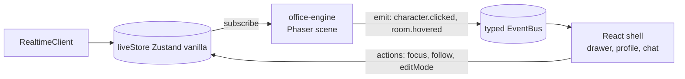

# FRONTEND_ARCHITECTURE — Kiến trúc frontend (apps/web)

> Tác giả: System Architect · Phase 0 (chỉ tài liệu) · Draft v0.1 · 2026-10-30
> Nhãn: **[Đã xác minh]** (có nguồn) · **[Đề xuất]** · **[Giả định]** · **[Cần người dùng phê duyệt]**. Các D-xxx đều "Chờ duyệt" (`DECISION_LOG.md`).
> Liên quan: `docs/SYSTEM_ARCHITECTURE.md`, `docs/API_DOCUMENTATION.md`, `docs/design/NAVIGATION_STRUCTURE.md`, `docs/design/DESIGN_SYSTEM.md`, `docs/design/DESIGN_TOKENS.md`.

---

## 1. Mục đích

Định nghĩa cấu trúc `apps/web`: cây thư mục, routing, phân chia state (Zustand / TanStack Query), realtime client, design-system package, ranh giới tích hợp Phaser, Monaco, React Flow, quy tắc hiệu năng cho luồng event trực tiếp, i18n và kiểm thử.

## 2. Phạm vi

- **Trong:** app structure, routing, state, realtime, design system, Phaser/Monaco/React Flow boundary, performance, i18n, testing.
- **Ngoài:** thiết kế thị giác chi tiết (xem `docs/design/*`), endpoint (xem `API_DOCUMENTATION.md`), kiến trúc Phaser nội bộ (thuộc `packages/office-engine`, tham khảo `docs/research/PIXEL_AGENTS_ANALYSIS.md`).

## 3. Nội dung chi tiết

### 3.1 Stack **[Đã xác minh]** từ `docs/research/LICENSE_AND_REUSE.md` §5.5 và D-001/D-011

**Khung frontend: chờ Owner xác nhận (Q-16)** · Vite 7 + TypeScript 5.9 · React 19.2 · Tailwind 4.1 (`@tailwindcss/vite`, cấu hình CSS-first `@theme`) · shadcn/ui + lucide-react · Phaser 3.90 · `@xyflow/react` 12 · Zustand 5 · TanStack Query 5 · socket.io-client 4. **[Đề xuất]** thêm: React Router (data router), Monaco (`@monaco-editor/react`), `react-hook-form` + Zod resolver, `i18next`, Vitest, Testing Library, Playwright, MSW.

### 3.2 Cấu trúc ứng dụng **[Đề xuất]**

```
apps/web/src/
  main.tsx  app/ (providers, router, shell)
  routes/                  # route modules (lazy), 1 file / màn hình
  features/                # theo domain, mỗi feature tự chứa
    dashboard/ activity/ projects/ office/ agents/ org/ skills/ workflows/
    tasks/ approvals/ workspace/ qa/ cost/ providers/ settings/ onboarding/
      api/        # query keys, hooks TanStack Query, mapper (dùng DTO từ @aiw/contracts)
      components/ # UI riêng feature
      store/      # Zustand slice chỉ cho client state của feature
      index.ts    # public API của feature
  shared/
    realtime/     # socket client, event router, batching
    api/          # http client, error mapper, idempotency
    hooks/ lib/ i18n/ test/
```

Quy tắc: feature chỉ import feature khác qua `index.ts`; `shared` không import `features`; component dùng chung nằm ở `@aiw/ui`, không nằm trong `shared`.

### 3.3 Routing (từ NAVIGATION_STRUCTURE)

**[Đã xác minh]** Route map ở `docs/design/NAVIGATION_STRUCTURE.md` §4.1 và §7; tài liệu này chỉ quy định cách dựng.

| Nhóm | Route | Ghi chú |
|---|---|---|
| Landing | `/` redirect `/dashboard` | Setting "Default landing" (Dashboard/Office) chưa chốt (NAV §16 mục 1) |
| Overview | `/dashboard`, `/activity` | global |
| Projects | `/projects`, `/projects/new`, `/projects/:projectId`, `/projects/:projectId/preview` | |
| Office | `/office?focus=&project=&mode=edit` | global |
| Agents | `/agents?view=grid\|list\|org`, `/agents/new?step=1..6`, `/agents/:agentId?tab=` | tab và view trong query |
| Org | `/org`, `/org/departments`, `/org/departments/:deptId` | |
| Skills | `/skills`, `/skills/new`, `/skills/:skillId/edit` | |
| Project-scoped | `/projects/:projectId/{workflows[/:workflowId]|tasks|workspace|qa[/runs/:runId]}` | project luôn có trong URL |
| Approvals | `/approvals`, `/approvals/:approvalId?tab=diff&file=` | |
| Cost / Providers | `/cost`, `/providers[/:providerId?tab=]` | |
| Settings | `/settings/:section` | general, appearance, providers, security, notifications, office, shortcuts, about |
| Onboarding | `/welcome` | redirect nếu chưa có provider (NAV §11) |

Triển khai:
- Router dạng **data router** với `lazy()` theo route để code-split; Phaser, Monaco, React Flow nằm trong chunk riêng chỉ tải khi vào `/office`, `/projects/:id/workspace`, `/projects/:id/workflows/*`.
- Alias ngắn (`/tasks`, `/workflows`, `/workspace`, `/qa`) redirect theo `currentProjectId` (lưu `localStorage`); khi redirect hiển thị banner 3 s (NAV §15). **[Cần người dùng phê duyệt]** canonical `/projects/:projectId/...` (NAV §13).
- Path = identity, query = trạng thái UI phụ (tab, view, filter, drawer). Query param được parse bằng Zod trong `loader`; giá trị sai thì fallback mặc định, không lỗi.
- Guard: `requireProvider` (redirect `/welcome`), `requireProject` (redirect `/projects` với empty-state), `requireRole` ẩn mutation cho Viewer (ẩn, không chỉ disable: NAV §8.2).
- Shell: sidebar 240/56 px, topbar 48 px, breadcrumb sinh từ `handle.crumb` của route match; Command Palette (`Ctrl/Cmd+K`) đăng ký lệnh từ feature qua registry.
- Mobile: chỉ monitoring + approvals (NAV §12) **[Cần người dùng phê duyệt]**; route desktop-only hiển thị "Mở trên desktop".

### 3.4 Phân chia state: TanStack Query vs Zustand

**[Đã xác minh]** quyết định cặp này: LICENSE_AND_REUSE §5.4; D-011 yêu cầu Zustand cho cầu nối React ↔ Phaser.

| Loại state | Công cụ | Ví dụ |
|---|---|---|
| Server state (dữ liệu có nguồn ở backend, cache được) | **TanStack Query** | agents, tasks, approvals, workflows, usage, danh sách session |
| Client state (UI, ephemeral, không cần server) | **Zustand** | sidebar, selection, command palette, editor mode, theme, onboarding tick, draft form |
| Live runtime state (cập nhật tần suất cao, tách khỏi Query cache) | **Zustand `liveStore`** (vanilla store, `subscribe`) | agent presence/status, output đang stream, vị trí nhân vật, counters |
| Form state | react-hook-form + Zod | Agent Builder, Skill Editor |
| URL state | Router search params | tab, view, filter, file/line |

Quy tắc:
1. Không copy dữ liệu từ Query vào Zustand (nguồn sự thật kép). Zustand chỉ giữ ID đã chọn và cờ UI.
2. `liveStore` chỉ chứa dữ liệu "nóng" do event realtime điều khiển; khi cần dữ liệu đầy đủ thì lấy từ Query (REST), event chỉ patch.
3. Query key theo factory trong `features/*/api/keys.ts`; mutation dùng `Idempotency-Key` (xem API §3.4).
4. Hợp nhất realtime vào cache: event `entity.updated` → `queryClient.setQueryData` (patch) hoặc `invalidateQueries` (khi không chắc). Badge sidebar debounce 1–2 s (NAV §4.1).
5. Store bên ngoài React (`createStore` vanilla) để Phaser đọc bằng `getState()/subscribe` mà không phụ thuộc React (D-011, LICENSE_AND_REUSE §5.4).

### 3.5 Realtime client

- socket.io-client, namespace `/realtime`; handshake gửi token qua subprotocol hoặc first-message (không query string; `SECURITY.md` §7). Trạng thái kết nối (connected/reconnecting/offline) hiển thị cuối sidebar (NAV §4.1).
- **`RealtimeClient`** (singleton trong `shared/realtime`): quản lý subscribe theo room (`org`, `project`, `run`, `agent`, `session`, `office`), ref-count để chỉ subscribe khi có màn hình cần.
- **Envelope và replay**: mỗi event có `id` (cursor) và `sequence` (per session). Khi reconnect gửi `lastEventId`; nếu thấy gap `sequence > last+1` thì gọi REST `GET /sessions/:id/events?afterSeq=` (DATABASE_DESIGN §5.4). Bỏ qua event `sequence <= lastSeq` (dedupe).
- **Event router**: `Map<eventType, handler[]>`; mỗi feature đăng ký handler (patch cache, cập nhật liveStore, tạo toast theo taxonomy NAV §10).
- **Batching**: event đến được gom bằng `requestAnimationFrame`/khung 50–100 ms rồi áp dụng một lần (xem §3.10).
- Chỉ `critical` và `approval.requested` toast không auto-dismiss, tối đa 3 toast (NAV §10).
- Lệnh điều khiển (pause/resume/cancel) dùng socket ack hoặc REST; UI optimistic chỉ cho thao tác không phá hủy.

### 3.6 Design system package (`@aiw/ui`, `@aiw/design-tokens`)

- **[Đã xác minh]** quyết định thị giác ở D-015: accent AI tím `--ai-accent`, Inter + JetBrains Mono, mật độ Comfortable, avatar agent bo vuông / người tròn, mặc định tiếng Anh. Chi tiết ở `docs/design/DESIGN_TOKENS.md`, `DESIGN_SYSTEM.md` (không lặp lại ở đây).
- `@aiw/design-tokens`: token dạng CSS variables + TS constants, build ra file CSS Tailwind v4 `@theme`. Không đặt giá trị màu cứng trong feature.
- `@aiw/ui`: component dựa shadcn/ui (copy-in), bọc thành API ổn định: `Sidebar`, `Topbar`, `Badge(count)`, `Tooltip`, `Toast`, `ConfirmDialog`, `CommandPalette`, `Drawer`, `DataTable`, `StatusDot`, `AgentAvatar`. **[Đề xuất]** có Storybook hoặc trang gallery nội bộ để Phaser/FE cùng xem (cần Owner chốt, xem §7).
- Component không biết API/store: nhận props; lệnh phá hủy luôn đi qua `ConfirmDialog` (NAV §8.2).
- Accessibility: focus ring, aria cho cập nhật live (`aria-live="polite"` cho toast), phím tắt không kích hoạt khi focus trong input/Monaco/terminal (NAV §9).

### 3.7 Phaser integration boundary (Virtual Office)

**[Đã xác minh]** D-011: Phaser 3.90, React ↔ Phaser qua Zustand store + event bus; chuyển động chỉ do event thực điều khiển; tham khảo Pixel Agents (BFS, FSM, layout editor), không sao chép từ My Virtual Office (AGPL, D-012).



Ranh giới **[Đề xuất]**:
- `packages/office-engine` **không import React, không gọi HTTP/Socket**. Nó nhận `OfficeSnapshot` + stream `OfficeEvent` (đã chuẩn hóa) và phát lên một `EventBus` có kiểu.
- `features/office` là lớp keo duy nhất: mount canvas trong `useEffect`, `game.destroy(true)` khi unmount (tránh leak WebGL context), truyền `liveStore` adapter.
- Overlay UI (HUD, speech bubble dạng DOM nếu cần, click-to-interact drawer) là React; sprite, animation, pathfinding là Phaser.
- Dữ liệu vào Phaser chỉ từ event thật (PRD §5.6); không có animation giả/idle ngẫu nhiên đóng vai hoạt động.
- Vị trí/animation do backend `office projector` tính và gửi (ephemeral `office.moved`/`office.animation` qua Redis, DATABASE_DESIGN §5.2, §10); FE chỉ nội suy.
- Asset chỉ CC0/MIT/OFL (D-012).
- Test: scene chạy headless với `Phaser.HEADLESS`, snapshot FSM; engine test độc lập với React.

### 3.8 Monaco (Code Workspace)

- Tải lười trong chunk riêng; worker cấu hình qua Vite (`?worker`), không CDN bên ngoài (desktop/offline) **[Đề xuất]**.
- Chế độ: edit (khi owner mở) và **diff read-only** cho Approval và mobile (NAV §12).
- File tree/lịch sử lấy từ REST của module `workspace`; ghi file từ UI đi qua API có kiểm tra manifest, không ghi trực tiếp đĩa.
- Phím: `Ctrl+P` quick open, `Ctrl+Backquote` terminal, `Ctrl+Shift+G` git panel (NAV §9). Khi focus trong Monaco chỉ `Ctrl/Cmd+K` và `Esc` là global.
- Model Monaco được dispose khi đóng tab; giới hạn số model mở (ví dụ 20) để tránh dùng RAM quá mức **[Giả định]** giá trị này.

### 3.9 React Flow (Workflow Builder)

- `@xyflow/react` 12 (MIT; cần badge attribution hoặc Pro: LICENSE_AND_REUSE §5.2) **[Đã xác minh]**.
- Định nghĩa workflow là JSON tương thích React Flow, kiểu và validator nằm ở `@aiw/workflow-schema` dùng chung với BE (ORCHESTRATION §3.1). FE không tự định nghĩa lại kiểu node.
- Node types: Agent, Approval, Condition, Parallel, Merge, Tool, Test, Deployment (PRD §5.5). Mỗi node là component memo hoá; `nodeTypes` khai báo ngoài component (tránh re-render).
- Chế độ xem run: overlay trạng thái node từ `liveStore` (`NODE_*` events), không ghi vào định nghĩa.
- Dry-run gọi API, kết quả hiển thị trên đồ thị. Phím: `Delete`, `Ctrl+Z/Y`, `Ctrl+D`, `F`, `Ctrl+Enter` (NAV §9).
- Định nghĩa đã publish là bất biến (run pin `definitionVersionId`; ORCHESTRATION §10); chỉnh sửa tạo version nháp.

### 3.10 Quy tắc hiệu năng cho live events

**[Đề xuất]**, nhằm xử lý tối đa 18 agent + event stream tần suất cao:

1. **Batch + coalesce**: gom event theo khung 50–100 ms; với cùng khóa (`agentId`, `status`) chỉ giữ giá trị cuối.
2. **Chunk output**: `AGENT_OUTPUT_CHUNK`/`llm.stream_chunk` không đi qua React state từng chunk; ghi vào ring buffer ngoài React và render bằng virtualized list ở nhịp `rAF`. Giữ tối đa N dòng trong bộ nhớ (ví dụ 5 000) **[Giả định]**, phần còn lại lấy qua REST/artifact.
3. **Selector hẹp**: dùng `useStore(selector, shallow)`; không đọc toàn bộ store. Component danh sách dùng `React.memo` + key ổn định.
4. **Virtualization** cho Activity feed, Tasks table, log console (ví dụ `@tanstack/react-virtual`).
5. **Tách luồng**: dữ liệu office/animation không qua TanStack Query cache; đi thẳng `liveStore` → Phaser. Khi tab ẩn (`document.hidden`) tạm dừng Phaser và giảm tần suất flush.
6. **Throttle**: `AGENT_HEARTBEAT` throttle 5 s ở nguồn (ORCHESTRATION §7.2); badge debounce 1–2 s.
7. **Code-split** chunk nặng (Phaser, Monaco, React Flow); không tải ở shell.
8. **Ngân sách**: mục tiêu đề xuất, chưa đo: shell JS ban đầu nhỏ, 60 fps office ở 18 agent, không long task > 50 ms khi nhận burst event. **[Giả định]** cần benchmark ở Phase 2 trước khi coi là yêu cầu.
9. **Backpressure**: nếu hàng đợi event ở FE vượt ngưỡng, bỏ event ephemeral cũ và yêu cầu snapshot (không bỏ event bền vững).

### 3.11 i18n

- **[Đã xác minh]** Mặc định tiếng Anh, VI là locale thứ hai (D-015).
- **[Đề xuất]** `i18next` + `react-i18next`; namespace theo feature; key dạng `feature.section.label`; dữ liệu do backend trả (tên phòng ban/agent seed) có `slug` ổn định, FE dịch theo slug khi có bản dịch, không dịch nội dung người dùng nhập.
- Định dạng ngày/giờ/tiền bằng `Intl` với locale đang chọn; thời gian từ backend là UTC ISO.
- Test: lint kiểm tra key thiếu ở locale phụ; snapshot bố cục với chuỗi VI dài hơn.

### 3.12 Testing

| Tầng | Công cụ | Phạm vi |
|---|---|---|
| Unit | Vitest | hook, mapper, event router, reducer liveStore |
| Component | Testing Library | `@aiw/ui`, form, ConfirmDialog, phím tắt |
| Contract | MSW + `@aiw/contracts` | mock API đúng schema; fail khi lệch DTO |
| Realtime | fake socket server | reconnect, gap, dedupe, replay |
| Engine | Vitest + Phaser headless | `office-engine` FSM/BFS |
| E2E | Playwright (`e2e/`) | onboarding, tạo agent, approval, preview |
| A11y | axe trong Playwright | màn chính |
| Visual | Playwright screenshot | design-system gallery |

## 4. Quyết định & lý do

| # | Quyết định | Lý do | Nhãn |
|---|---|---|---|
| F-1 | Query cho server state, Zustand cho client + live state | Tránh nguồn kép; Phaser đọc store ngoài React | [Đã xác minh] LICENSE_AND_REUSE §5.4, D-011 |
| F-2 | `liveStore` tách khỏi Query cache | Event tần suất cao không làm invalidate cache | [Đề xuất] |
| F-3 | `office-engine` là package không phụ thuộc React | Ranh giới Phaser rõ, test riêng | [Đề xuất] |
| F-4 | Route theo NAVIGATION_STRUCTURE, canonical có `projectId` | Một đối tượng một URL | [Đã xác minh] NAV §3; phê duyệt: [Cần người dùng phê duyệt] |
| F-5 | Lazy-load Phaser/Monaco/React Flow | Shell nhẹ | [Đề xuất] |
| F-6 | Zod ở contracts cho DTO + query param + form | Một nguồn schema | [Đề xuất] |
| F-7 | Socket.IO client, replay bằng `lastEventId` + `afterSeq` | Reconnect tin cậy | [Đã xác minh] D-014 |
| F-8 | Batch event 50–100 ms | Tránh render bão | [Đề xuất] |

## 5. Dependencies

- `@aiw/contracts`, `@aiw/workflow-schema`, `@aiw/office-engine`, `@aiw/ui`, `@aiw/design-tokens` (xem `SYSTEM_ARCHITECTURE.md` §3.3).
- Backend: REST + Socket.IO theo `API_DOCUMENTATION.md`; contract DTO đóng băng trước khi làm song song (API §10).
- Thư viện: React 19, Vite 7, Tailwind 4, Zustand, TanStack Query, Phaser 3.90, @xyflow/react 12, Monaco, socket.io-client, i18next.
- Thiết kế: `docs/design/*`, `docs/product/FUNCTIONAL_REQUIREMENTS.md`.

## 6. Rủi ro

| Rủi ro | Giảm thiểu |
|---|---|
| Burst event làm giật UI | batching, virtualization, ring buffer (§3.10) |
| Rò rỉ WebGL/Phaser khi đổi route | `destroy(true)` trong cleanup, test mount/unmount |
| Lệch route giữa FE và backend `deepLink` | backend trả `entityRef`, FE có một hàm `buildDeepLink` duy nhất (NAV §15) |
| Monaco/Phaser nặng, tải chậm | code-split, preload khi hover link |
| Zustand + Query dữ liệu lệch nhau | quy tắc §3.4, không copy |
| React Flow license badge | giữ attribution hoặc mua Pro |
| Phaser 4 vs 3.90 | giữ engine sau interface `office-engine`; cân nhắc 4 sau (D-011) |
| Chord shortcut xung đột Monaco/terminal | scope phím theo focus (NAV §9) |
| Token trong WS handshake ở chế độ trình duyệt thuần | dùng subprotocol/first-message, không query string |

## 7. Vấn đề chưa giải quyết

1. Landing mặc định Dashboard hay Office (NAV §16 mục 1).
2. Một office toàn cục hay mỗi project (NAV §16 mục 5).
3. Có Storybook hay chỉ trang gallery nội bộ?
4. Viewer có thấy Cost và Provider Hub không (NAV §16 mục 3)?
5. Router: React Router data router hay TanStack Router? (chọn React Router ở đây vì quen thuộc; **[Cần người dùng phê duyệt]**).
6. Ngân sách hiệu năng (fps, kích thước bundle) chưa đo.
7. Sidebar gom 4 cụm hay giữ 14 nhóm phẳng (NAV §16 mục 2).
8. Phaser 3.90 hay chuyển Phaser 4.

## 8. Acceptance Criteria

- [ ] Mọi route trong NAV §4.1 và §7 mở được trực tiếp bằng URL, không phụ thuộc state trước đó.
- [ ] Phaser, Monaco, React Flow chỉ nằm trong chunk riêng; shell không import chúng (kiểm bằng phân tích bundle).
- [ ] `office-engine` không có import `react`/`react-dom` (lint).
- [ ] Rời `/office` rồi quay lại 20 lần không tăng WebGL context/RAM đáng kể.
- [ ] Reconnect socket: không mất, không trùng event (test gap + dedupe với fake server).
- [ ] Không có dữ liệu server state trong Zustand (review checklist + lint tùy chọn).
- [ ] Lệnh phá hủy luôn hiển thị `ConfirmDialog`; Emergency stop yêu cầu gõ `STOP`.
- [ ] Mọi chuỗi hiển thị qua i18n; bộ key EN đầy đủ, VI thiếu thì fallback EN.
- [ ] MSW mock sinh từ `@aiw/contracts`; đổi DTO thì build FE fail nếu không cập nhật.
- [ ] Benchmark 18 agent giả lập event 10 tick/s giữ UI phản hồi (số liệu ghi vào tài liệu hiệu năng).
