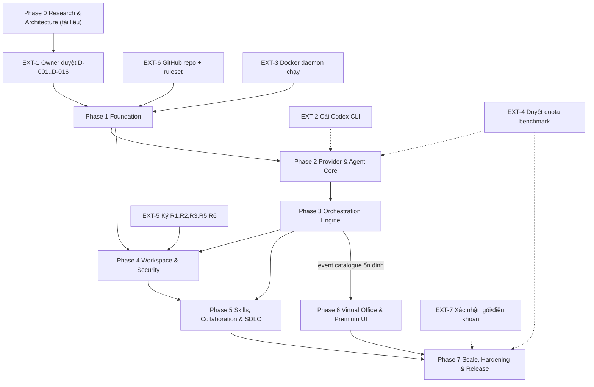

# IMPLEMENTATION ROADMAP — AI WORKSPACE (Phase 0 → Phase 7)

Trạng thái: DRAFT (Phase 0). Ngày: 2026-10-30. Tác giả: Delivery/Engineering Lead.
Ký hiệu: [Đã xác minh] / [Đề xuất] / [Giả định] / [Cần người dùng phê duyệt].
Nguồn: `DECISION_LOG.md` (D-001…D-016), `WORK_PLAN.md`, `product/FUNCTIONAL_REQUIREMENTS.md` (FR-001…FR-292), `product/ACCEPTANCE_CRITERIA.md` (AC-001…AC-130), `architecture/*`, `SECURITY.md`, `research/MULTI_AGENT_SCALABILITY.md`, `development/*`.
Vai trò (18 role seed, `architecture/AGENT_ORGANIZATION.md` §4): `pm, ba, architect, uiux, frontend, backend, db_infra, qa, security, reviewer, research, integration, performance, devsecops, docs, ux_research, test_automation, release`.

---

## 1. Mục đích

Chuyển thiết kế Phase 0 thành kế hoạch thực thi theo 8 phase (0-7): mục tiêu, module, task có ID, vai trò chịu trách nhiệm, phụ thuộc, đầu vào/đầu ra, tiêu chí chấp nhận gắn AC, kế hoạch test, tiêu chí thoát (exit criteria) và rủi ro. Cho biết task nào chạy song song, task nào phải chờ. Có bảng phân rã Phase 1 sẵn sàng giao việc. Bằng chứng chạy 18 agent đồng thời là **exit criterion tường minh** của Phase 7.

## 2. Phạm vi

- Trong: lộ trình xây nền tảng AI WORKSPACE đến MVP (167 FR phase MVP, 100 AC) và chuẩn bị P2 (OpenHands, Tauri, generic CLI).
- Ngoài: lịch theo ngày giờ cụ thể (phụ thuộc quota và Owner), kế hoạch kinh doanh, hỗ trợ đa người dùng/server mode đầy đủ (chỉ chuẩn bị).
- Không tạo mã trong Phase 0. [Đã xác minh]

## 3. Nội dung chi tiết

### 3.1 Quy ước đọc roadmap [Đề xuất]

| Ký hiệu | Ý nghĩa |
|---|---|
| ID `Pn-xx` | Task thuộc Phase n. `P1-0x` nền, `P1-1x` backend, `P1-2x` DB, `P1-3x` frontend, `P1-4x` provider, `P1-5x` agent/org, `P1-6x` test/CI, `P1-7x` tích hợp |
| Wave `W0, W1, …` | Task cùng wave trong cùng phase **chạy song song** (mỗi task một worktree, file ownership tách rời). Wave sau chỉ bắt đầu khi các task `Chờ` của nó xong |
| `Chờ` | Phụ thuộc cứng (task, quyết định Owner, điều kiện môi trường) |
| `EXT-x` | Điều kiện ngoài do Owner xử lý (bảng 3.3) |
| Trạng thái | `TODO`, `IN_PROGRESS`, `IN_REVIEW`, `COMPLETED`, `IMPLEMENTED-UNVERIFIED`, `BLOCKED(lý do)` (DoD: `DEVELOPMENT_GUIDE.md` §3.9) |
| Cỡ | S ≤ 0,5 ngày agent · M ≈ 1-2 ngày · L ≈ 3-5 ngày [Giả định, chưa hiệu chuẩn] |

Ràng buộc song song [Đã xác minh]: tối đa 10 subagent đồng thời (WORK_PLAN); quota subscription dùng chung (một tài khoản claude.ai team); do vậy Orchestrator không bao giờ khởi chạy hết wave nếu wave > 10 task, mà chia lô.

### 3.2 Tổng quan phase

| Phase | Tên | Mục tiêu một câu | Kết quả có thể chứng minh | FR chính | AC chính |
|---|---|---|---|---|---|
| 0 | Research & Architecture | Chốt thiết kế, rủi ro, quyết định | Bộ tài liệu + Owner duyệt D-001…D-016 | — | — |
| 1 | Foundation | Repo, CI, contract, DB, backend/frontend skeleton, vertical slice đầu tiên | Tạo company + agent qua UI, event thật về UI qua WebSocket | FR-001…004, 021-025 (một phần), 116-118 | AC-002, 015, 058, 059 |
| 2 | Provider & Agent Core | Kết nối Claude Code thật; quản lý agent đầy đủ; chat | Agent chạy một message thật qua adapter, stream về UI | FR-021…050, 076…097 | AC-001…009, 021…034 |
| 3 | Orchestration Engine | Workflow bền vững, scheduler, approval, recovery | 5 task đồng thời thật, kill app rồi resume | FR-101…111, 116…118, 286…291 | AC-043…046, 055…064, 121…130 |
| 4 | Workspace & Security | Worktree/manifest, hook, sandbox Docker, Emergency Stop | Agent bị chặn ghi ngoài ownership; lệnh chạy trong container | FR-039, 206…218 | AC-011, 101…114 |
| 5 | Skills, Collaboration & SDLC | Skill/Teach, message bus, SDLC 8 stage end-to-end | Một project nhỏ chạy từ prompt tới Human Acceptance | FR-051…068, 119…135, 231…260 | AC-041…054, 071…082 |
| 6 | Virtual Office & Premium UI | Office 2D, 22 màn hình, dashboard | Office phản ứng đúng event thật; 18 nhân vật ≥ 30 FPS | FR-151…195, 261…285 | AC-086…100 |
| 7 | Scale, Hardening & Release | Chứng minh 18 đồng thời, độ tin cậy, giấy phép, đóng gói | Báo cáo T7; 20/20 recovery; Owner nghiệm thu | FR-232, 245, 292; NFR | AC-048, 063, 064, 095, 127 |

Các phase không nối tiếp tuyệt đối: Phase 6 (Office, màn hình) bắt đầu song song với Phase 5 sau khi catalogue event ổn định (cuối Phase 3); Phase 2 và Phase 4 có việc song song (xem sơ đồ 3.4).

### 3.3 Điều kiện ngoài (EXT) cần Owner [Đã xác minh nguồn trạng thái]

| ID | Điều kiện | Trạng thái hiện tại | Chặn task | Người xử lý |
|---|---|---|---|---|
| EXT-1 | Phê duyệt D-001…D-016 và giải quyết 5 mâu thuẫn trong `DECISION_LOG.md` | Chờ duyệt | P1-01 trở đi (D-001, D-002), P4 (D-007) | Owner |
| EXT-2 | [HOÃN, D-005/OWR-2: không cài Codex CLI trong phạm vi hiện tại] Cài Codex CLI (`npm i -g @openai/codex`) và `codex login` | Chưa cài; không được cài | P2-11, P2-12, P4-11, AC-022 | Owner |
| EXT-3 | Docker daemon đang chạy (Docker Desktop 29.8.1 đã cài; daemon chưa chạy lúc kiểm tra) | Chưa chạy | P1-20, P1-62 (integration), mọi P4 sandbox | Owner |
| EXT-4 | Phê duyệt quota chạy benchmark T1-T4 (≈ 89 spawn nhẹ, ≈ 33 USD list) | Chờ | P2-13, P7-01 | Owner |
| EXT-5 | Ký xác nhận rủi ro còn lại R1, R2, R3, R5, R6 (`SECURITY.md` §10) | Chưa | P4 exit | Owner |
| EXT-6 | Tạo GitHub repo/remote, bật ruleset | Chưa (thư mục chưa là git repo) | P1-01 | Owner |
| EXT-7 | Xác nhận gói subscription và điều khoản chạy nhiều phiên song song | Chưa xác minh | P7-01 (N>5) | Owner |
| EXT-8 | Quyết định fallback khi không có Docker (FR-216, AC-114) | Chưa | P4-14 | Owner |

### 3.4 Sơ đồ phụ thuộc (Mermaid) [Đề xuất]

Sơ đồ cấp phase và cổng ngoài:

Sơ đồ task xương sống (đường găng) [Đề xuất]:

```mermaid
flowchart LR
    P101["P1-01 Init repo"] --> P102["P1-02 Monorepo + lint"]
    P102 --> P103["P1-03 AGENTS.md"]
    P102 --> P104["P1-04 Contracts + events freeze"]
    P104 --> F1["P1-1x Backend"]
    P104 --> F2["P1-2x DB"]
    P104 --> F3["P1-3x Frontend"]
    P104 --> F4["P1-4x Provider SDK"]
    P104 --> F5["P1-5x Agent/Org"]
    P102 --> F6["P1-6x Test + CI"]
    F1 --> P170["P1-70 Vertical slice"]
    F2 --> P170
    F3 --> P170
    F5 --> P170
    F6 --> P170
    F4 --> P201["P2-01 ClaudeCodeAdapter full"]
    P170 --> P201
    P201 --> P205["P2-05 Chat + streaming"]
    P201 --> P210["P2-10 Real provider tests"]
    P170 --> P301["P3-01 DAG executor"]
    P205 --> P301
    P301 --> P304["P3-04 Redis semaphore"]
    P301 --> P306["P3-06 Approval WAITING_HUMAN"]
    P304 --> P312["P3-12 Concurrency 5 -> 10 real"]
    P301 --> P307["P3-07 Checkpoint + recovery"]
    P312 --> P401["P4-01 Worktree manager"]
    P401 --> P402["P4-02 Manifest + hooks"]
    P402 --> P404["P4-04 Docker sandbox"]
    P404 --> P507["P5-07 SDLC template"]
    P306 --> P507
    P507 --> P513["P5-13 E2E SDLC thật"]
    P513 --> P701["P7-01 18-concurrency proof"]
    P312 --> P701
    P701 --> P708["P7-08 Owner acceptance"]
```

### 3.5 Phase 0 — Research & Architecture [Đã xác minh trạng thái]

**Mục tiêu:** Có đủ nghiên cứu, thiết kế và hướng dẫn để Phase 1 bắt đầu mà không phải đoán.

**Module/tài liệu:** research (ChatDev, Pixel Agents, MVO, OpenHands, Claude, Codex, Orchestration, License, Scalability), kiến trúc (Organization, Collaboration, Scheduler, Resource, Workspace, Skill, Infrastructure), `DATABASE_DESIGN`, `SECURITY`, sản phẩm (PRD, SRS, FR, NFR, AC, flows, roles), design (system, tokens, screens, navigation, interaction, responsive), development (environment, CI/CD, deployment, guide, testing, standards), roadmap, risks.

| ID | Task | Role | Wave | Chờ | Output | Trạng thái |
|---|---|---|---|---|---|---|
| P0-01…P0-11 | Nghiên cứu/thiết kế theo WORK_PLAN §1 | research, architect, integration, security, db_infra, uiux | W1 | — | docs tương ứng | Đã có tài liệu (theo thư mục `docs/`) |
| P0-12 | Tổng hợp: ARCHITECTURE_COMPARISON, REUSE_DECISIONS, SYSTEM_ARCHITECTURE, `docs/adr/*` | architect (Orchestrator) | W2 | P0-01…P0-11 | 4 mục tài liệu | TODO (thư mục `docs/adr` đang trống) |
| P0-13 | Hướng dẫn phát triển: DEVELOPMENT_GUIDE, TESTING, CODING_STANDARDS, COMPONENT_SPECIFICATION, ROADMAP, PROJECT_RISKS | pm (Delivery Lead) | W2 | tài liệu W1 | 6 file này | Hoàn thành bản nháp |
| P0-14 | Owner duyệt D-001…D-016; giải quyết mâu thuẫn | Owner | W3 | P0-12, P0-13 | DECISION_LOG cập nhật "Đã duyệt" | TODO — cổng EXT-1 |
| P0-15 | Owner xử lý EXT-2, EXT-3, EXT-6 | Owner | W3 | — | CLI/Docker/Repo sẵn sàng | TODO |
| P0-16 | Đồng bộ mâu thuẫn tài liệu (bảng 3.14) | architect, ba | W3 | P0-12 | docs sửa | TODO |

**AC Phase 0:** (a) mọi tài liệu có đủ 8 mục chuẩn; (b) mọi quyết định có trạng thái duyệt; (c) bảng rủi ro `PROJECT_RISKS.md` có owner role.
**Test plan:** rà soát chéo (reviewer + ba) chuyển đổi thành checklist; lint markdown; kiểm link.
**Exit criteria:** EXT-1 xong (hoặc Owner chấp nhận bắt đầu Phase 1 với D-001, D-002 đã duyệt, phần còn lại duyệt trước phase tương ứng); EXT-6 xong; P0-16 xử lý các mâu thuẫn chặn contract (mục 3.14 #1, #2).
**Rủi ro:** R-SCOPE, R-APPROVAL-LAG (`PROJECT_RISKS.md`).

### 3.6 Phase 1 — Foundation

**Mục tiêu:** Có repo chạy được, CI xanh, contract chung đóng băng, DB/Backend/Frontend skeleton, provider SDK, và một **vertical slice** thật: tạo company → tạo agent từ template qua UI → event thật hiện trên UI qua WebSocket.

**Module:** `apps/api` (config, logging, errors, events/outbox/gateway, organization, agents), `apps/web` (app shell, tokens, primitives, API/WS client, i18n), `packages/{contracts,events,db,provider-sdk,testing}`, `infra/compose`, CI.

**Phụ thuộc đầu vào:** EXT-1 (tối thiểu D-001, D-002, D-014), EXT-6, EXT-3 (cho integration test; nếu Docker chưa chạy, các task cần DB chạy ở trạng thái `BLOCKED(EXT-3)`).

Phân rã chi tiết Phase 1 ở mục 3.13 (sẵn sàng thực thi).

**Acceptance (AC):** AC-002 (validation Agent Builder: name trống/trùng), AC-015 (tạo agent từ template: form điền sẵn), AC-058 (event có id/type/timestamp/actor/entity/payload/correlation), AC-059 (tắt event bus → UI không cập nhật), AC-021 ở mức spike (CheckConnection Claude thật, chưa Connect đầy đủ). Hạ tầng: `pnpm lint/typecheck/test/test:int/test:e2e` xanh trên CI.

**Test plan:** unit (state machine agent, DTO), integration (outbox → Redis → WS với Postgres/Redis thật), contract (OpenAPI/event snapshot), E2E-02 phiên bản rút gọn, security (gitleaks, no-secret-in-web, bundle check).

**Exit criteria:**
1. CI `ci-ok` xanh trên `main` với ruleset bật; PR dry-run theo DoD đã qua (P1-72).
2. Vertical slice P1-70 chạy được bằng một lệnh `pnpm dev` và có video/log làm bằng chứng.
3. `AGENTS.md` được Owner duyệt; agent mới tự định hướng được (kiểm bằng một agent mới thực hiện task nhỏ chỉ từ `AGENTS.md`).
4. Contract (`packages/contracts`, `packages/events`) đóng băng phiên bản 0.1; bảng ánh xạ trạng thái agent/task/tone chốt (xử lý mâu thuẫn #1, #2).
5. Seed tạo đúng 18 `AgentTemplate` `isSeed=true` và 12 phòng ban mặc định (FR-003) từ file dữ liệu, không hardcode.
6. Chưa có mock data trong luồng sản phẩm (kiểm bằng lint F-03).

**Rủi ro:** Docker daemon chưa chạy (R-DOCKER), mâu thuẫn trạng thái (R-CONTRACT-DRIFT), chọn ORM chưa duyệt, Windows path/shell.

### 3.7 Phase 2 — Provider & Agent Core

**Mục tiêu:** Adapter Claude Code thật hoạt động đủ 13 operation; quản lý agent đầy đủ (Builder, Detail 10 tab, Pause/Resume/Disable/Delete); chat trực tiếp với agent; credential không bao giờ lộ.

**Module:** `packages/adapters-claude`, `apps/api/modules/{providers,agents,conversations,usage}`, `apps/web/features/{providers,agents}`, `packages/policy/redaction`.

| ID | Task | Role | Wave | Chờ | Input → Output | FR / AC |
|---|---|---|---|---|---|---|
| P2-01 | ClaudeCodeAdapter đủ 13 operation qua `@anthropic-ai/claude-agent-sdk` (D-004), lỗi ánh xạ chuẩn, `NOT_SUPPORTED` rõ | integration | W1 | P1-40, P1-41, P1-70 | provider-sdk → adapter + golden fixtures | FR-076, 080-083, 093-097 / AC-021, 025-028, 034 |
| P2-02 | Provider Hub backend: trạng thái kết nối, model, usage, lỗi gần nhất, session registry | backend | W1 | P1-40 | API + event `PROVIDER_*` | FR-092 / AC-033 |
| P2-03 | Credential guard: redaction middleware, response DTO không chứa secret, Semgrep rule cấm đọc file credential, scanner DB/log | security | W1 | P1-10 | `packages/policy/redaction` + test corpus 200 | FR-084-091 / AC-029, 030, 031 |
| P2-04 | Agent Builder backend: validation (name duy nhất, model ∈ ListModels), template, avatar | backend | W2 | P2-02 | API Agent CRUD đầy đủ | FR-021-023, 043 / AC-001-003, 015 |
| P2-05 | Chat + streaming: SendMessage → StreamEvents → conversation lưu DB | backend + integration | W2 | P2-01, P2-04 | WS stream + bảng conversation | FR-027, 094 / AC-009, 025 |
| P2-06 | Pause/Resume/Disable/Delete agent (ngữ nghĩa với session provider) | backend | W3 | P2-05 | state machine + hành động | FR-029-031 / AC-005-007, 014 |
| P2-07 | Usage/cost tracking per agent (ước tính có nhãn `estimated`) | backend | W3 | P2-05 | bảng usage + API | FR-041, 096 / AC-012 |
| P2-08 | FE Provider Hub (Connect/Disconnect, hướng dẫn Not installed/Not authenticated/Session expired) | frontend | W2 | P2-02 | màn `/providers` + `ProviderStatusCard` | FR-082-083, 089 / AC-023, 024, 027, 028 |
| P2-09 | FE Agent Management/Builder (6 bước)/Detail (10 tab) | frontend + uiux | W3 | P2-04, P2-05 | màn `/agents*` | FR-021, 026-028, 044 / AC-001-003, 008, 009 |
| P2-10 | Provider real tests (P-C): Connect, ListModels, SendMessage, Stream, CancelTask ≤ 5 s, Resume | test_automation | W3 | P2-01 | log thật `docs/evidence/` | AC-021, 026 (VERIFIED-REAL) |
| P2-11 | CodexAdapter qua `codex app-server`, dự phòng `codex exec --json` (D-005) | integration | W2 | P2-01, **EXT-2** | adapter + fixture | FR-077 / AC-022 |
| P2-12 | Codex real smoke (P-D) | test_automation | W4 | P2-11 | log thật | AC-022 |
| P2-13 | Benchmark T0-T4 (CLI thô, chưa cần app): 5/10/18 tiến trình nhẹ, số đo RAM/CPU/session_id | performance | W2 | **EXT-4**, P1-02 | `bench/` + báo cáo nháp | MULTI_AGENT §9 |
| P2-14 | Thử nghiệm giảm spawn tax (config dir tối giản) và đo lại | performance + integration | W3 | P2-13 | số đo trước/sau | RESOURCE_MANAGEMENT §4.3 |
| P2-15 | Tài liệu API + cập nhật contract 0.2 | docs + architect | W4 | P2-01…P2-09 | OpenAPI, docs | — |

**Song song/Chờ:** P2-01, P2-02, P2-03 chạy song song ngay sau Phase 1 (W1). P2-13 chạy song song độc lập với app nhưng chờ EXT-4. P2-11/12 chờ EXT-2; nếu EXT-2 chưa xong, đánh `BLOCKED(EXT-2)` và Phase 2 vẫn thoát được với Codex ở trạng thái UNVERIFIED (chấp nhận được nếu Owner đồng ý, xem exit criteria).

**Acceptance (AC):** AC-001…009, 012 (một phần), 014, 021, 023-029, 030-034 (Claude); AC-022 chỉ khi EXT-2.

**Test plan:** adapter conformance với FakeProvider (VERIFIED-MOCK) + P-C thật (VERIFIED-REAL) + E2E-01, E2E-02; security: AC-029-031 quét DB/log/payload; kiểm bundle không có FakeProvider.

**Exit criteria:**
1. Một message thật gửi qua UI → adapter → Claude Code → stream về UI, với `providerSessionId` và log lưu; không credential trong DB/log/payload (scanner xanh).
2. CancelTask dừng tiến trình ≤ 5 s (đo thật).
3. Trạng thái Not installed/Not authenticated hiển thị đúng với CLI giả lập (CI) và thật (tay).
4. Nếu EXT-2 xong: Codex smoke thật. Nếu chưa: Codex ghi `UNVERIFIED` trong `PROJECT_STATUS.md`, AC-022 chưa đạt, được Owner chấp nhận bằng văn bản.
5. Có số đo T1-T3 hoặc quyết định hoãn có ghi nhận (nếu EXT-4 chưa duyệt).

**Rủi ro:** R-TOS-QUOTA, R-CODEX-MISSING, R-COST (spawn tax ≈ 48k token/spawn [Đã xác minh]), R-CRED-LEAK.

### 3.8 Phase 3 — Orchestration Engine ("Conductor")

**Mục tiêu:** Workflow bền vững trên BullMQ + Postgres, scheduler phụ thuộc, semaphore đồng thời Redis Lua, approval `WAITING_HUMAN`, checkpoint và khôi phục sau crash; tăng đồng thời 5 → 10 bằng session thật.

**Module:** `apps/api/modules/{workflows,scheduler,tasks,approvals,events,recovery}`, `packages/events`, FE Task Board + Approval Center.

| ID | Task | Role | Wave | Chờ | Input → Output | FR / AC |
|---|---|---|---|---|---|---|
| P3-01 | DAG executor (node Agent/Condition/Parallel/Merge/Tool/Test/Approval/Deployment), trạng thái run ở Postgres | backend + architect | W1 | P2-05 | DAG schema → engine | FR-101, 104, 105, 113 |
| P3-02 | Task model + state machine 10 trạng thái, chuyển trạng thái chỉ qua event | backend | W1 | P1-51 | bảng task + guard | FR-107, 108, 025 / AC-060 |
| P3-03 | Scheduler: ready-set, priority hiệu dụng, AUTO scoring/MANUAL assign, queue/backpressure | backend | W2 | P3-01, P3-02 | `AGENT_SCHEDULER.md` → module | FR-109, 110, 231-235 / AC-055, 056 |
| P3-04 | Semaphore Redis Lua global + per-provider; stagger spawn ≤ 3/2 s; host guard RAM; rebuild từ Postgres | backend + performance | W2 | P3-03 | `RESOURCE_MANAGEMENT.md` → code | FR-232, 245 / AC-063 |
| P3-05 | Retry/backoff, handover sang agent khác khi hết retry | backend | W3 | P3-03 | policy → TASK_HANDOVER | FR-103, 111 / AC-057, 123 |
| P3-06 | Approval node `WAITING_HUMAN` không giữ worker + API Approval Center | backend | W2 | P3-01 | trạng thái + API | FR-106, 196-205 / AC-043-046 |
| P3-07 | Checkpoint (sau node, sau turn, trước approval), heartbeat ≤ 60 s, crash recovery | backend | W3 | P3-01, P3-04 | recovery service | FR-102, 286-291 / AC-121, 122, 124, 125 |
| P3-08 | Event store append-only phân vùng tháng, outbox đầy đủ catalogue FR-117, replay `lastEventId` | db_infra + backend | W1 | P1-11, P1-23 | partition + replay | FR-116-118 / AC-058 |
| P3-09 | Workflow pause/resume/cancel cấp workflow | backend | W3 | P3-07 | API | FR-133 / AC-062 |
| P3-10 | FE Task Board (kanban/table/timeline/graph) + `TaskCard` | frontend | W2 | P3-02 | màn `/tasks` | FR-107, 118 / AC-063 |
| P3-11 | FE Approval Center + `ApprovalCard`, `ApprovalQueue` | frontend | W2 | P3-06 | màn `/approvals` | FR-196-205 / AC-043-046 |
| P3-12 | Concurrency thật: 5 task đồng thời (prompt nhẹ), rồi 10, qua scheduler (T5-lite) | performance + qa | W4 | P3-04, P3-10, EXT-4 | log, session_id, task id | D-010 / AC-063 (5), một phần AC-064 |
| P3-13 | Test độ tin cậy: kill app giữa run, kill CLI, provider mất kết nối, task quá thời gian | qa + test_automation | W4 | P3-07 | E2E-07 + chaos | AC-121-130 |
| P3-14 | Workflow template lưu/chạy lại (data-driven, không hardcode) | backend | W3 | P3-01 | template CRUD | FR-114 / AC-061 |

**Song song/Chờ:** W1 (P3-01, P3-02, P3-08) song song. P3-03 chờ P3-01 và P3-02. P3-06 song song với P3-03 (cùng chờ P3-01). FE (P3-10, P3-11) chạy song song với backend của chúng khi contract đã chốt (có thể dùng fixture `packages/testing`, không dùng mock trong sản phẩm). P3-12 chờ mọi thứ và EXT-4.

**Acceptance (AC):** AC-043…046, 055…064 (AC-064 chỉ mức slot ở phase này), 058…060, 121…126, 128…130; AC-127 lặp 20 lần ở Phase 7.

**Test plan:** integration với Postgres/Redis thật cho semaphore Lua và recovery; property test state machine; chaos (kill process); E2E-03/04/07; provider thật ở P3-12 với prompt nhẹ.

**Exit criteria:**
1. Với concurrency=5 và 8 task READY: tối đa 5 RUNNING, 3 xếp hàng theo priority, UI đúng (AC-063) — bằng chứng log + task id + session id thật.
2. Kill app giữa workflow: mở lại thấy đúng trạng thái; Tiếp tục không chạy lại bước đã xong (AC-121/122).
3. Approval WAITING qua restart vẫn còn (AC-125).
4. Semaphore đúng sau chaos (`COUNT(RUNNING)` = semaphore) ở N=5; N=10 pass hoặc ghi rõ max hiệu dụng.
5. Catalogue event 0.x ổn định (cổng để Phase 6 khởi động).
6. Không workflow/agent hardcode (lint F-01, F-02 xanh).

**Rủi ro:** R-QUOTA-RATELIMIT, R-RAM-16GB, R-ENGINE-COMPLEXITY (tự xây engine — D-003), R-SCOPE.

### 3.9 Phase 4 — Workspace Isolation & Security

**Mục tiêu:** Mỗi task một worktree + branch; manifest quyền sở hữu; hook chặn thao tác; lệnh build/test chạy trong Docker; Emergency Stop; audit log; luồng `task → integration → main`.

**Module:** `apps/api/modules/{workspace,sandbox,security,audit}`, `packages/policy`, `infra/images`, hook scripts cho CLI.

| ID | Task | Role | Wave | Chờ | Input → Output | FR / AC |
|---|---|---|---|---|---|---|
| P4-01 | Workspace manager: bare repo, `git worktree`, đường dẫn ngắn Windows, cleanup/quota | backend + db_infra | W1 | P3-12, P1-02 | `WORKSPACE_AND_GIT_ISOLATION.md` → module | FR-124 |
| P4-02 | Ownership manifest + hook PreToolUse/`canUseTool`; diff validation trước merge | security + backend | W2 | P4-01 | manifest → enforcement | FR-039 / AC-011, 107 |
| P4-03 | Command policy: deny/ask/allow, normalizer (shell-quote, PowerShell tokenizer), ≥ 300 test | security | W1 | P1-02 | `packages/policy` | FR-209 / AC-103, 104 |
| P4-04 | Docker sandbox executor: mount workspace, giới hạn CPU/RAM/time, không credential | devsecops + backend | W2 | P4-01, **EXT-3** | `INFRASTRUCTURE_DESIGN.md` §6 → executor | FR-206, 207 / AC-101, 102, 105, 113 |
| P4-05 | Network modes: deny mặc định, allowlist qua proxy, phase install | devsecops | W3 | P4-04 | egress proxy | FR-211 / AC-106 |
| P4-06 | Audit log append-only (lệnh, file, approval, emergency stop) | backend | W2 | P3-08 | bảng + API + UI hook | FR-208 / AC-108 |
| P4-07 | Emergency Stop: dừng session + container ≤ 5 s; Resume từ checkpoint; nút trên mọi màn | backend + frontend | W3 | P4-04, P3-07 | API + `EmergencyStopButton` | FR-214 / AC-109, 110, 112 |
| P4-08 | Permission level L0-L4 theo role; chặn tạo branch/commit khi L1 | backend + security | W2 | P4-02 | enforcement | FR-215 / AC-111 |
| P4-09 | Luồng merge `task → integration/<project> → main` (người duyệt cuối) | backend | W3 | P4-02 | merge service | FR-124, D-009 |
| P4-10 | Bảo mật API localhost (token, Origin, WS auth), admin guard | security + backend | W1 | P1-11 | `SECURITY.md` §7 | NFR bảo mật |
| P4-11 | Cấu hình Codex sandbox/approval (mxc chưa xác minh trên build Windows 26300) | security + integration | W3 | P2-11, **EXT-2** | policy projection | FR-077 |
| P4-12 | Bộ security test CI (container config, egress, redaction, manifest, SAST) | test_automation + security | W3 | P4-02…P4-06 | `test:security` | AC-101-113 |
| P4-13 | Owner ký R1, R2, R3, R5, R6; ghi vào `PROJECT_RISKS.md` | pm + security | W4 | P4-12 | biên bản chấp nhận | **EXT-5** |
| P4-14 | Hành vi khi Docker không chạy (cảnh báo, chặn hoặc cho phép theo quyết định Owner) | backend + frontend | W3 | P4-04, **EXT-8** | cảnh báo UI | FR-216 / AC-114 |

**Song song/Chờ:** P4-01, P4-03, P4-10 bắt đầu cùng lúc (W1; P4-03 và P4-10 không chờ P3-12 nếu muốn khởi động sớm vì độc lập — Đề xuất chạy ngay sau Phase 1, chỉ P4-01 chờ P3-12). P4-04 chờ Docker thật chạy. P4-02/P4-08 chờ P4-01.

**Acceptance (AC):** AC-011, 101…114, 107, 113; AC-032.

**Test plan:** `SECURITY.md` §9 (nhóm 3.7 `TESTING.md`); bài kiểm hook với `claude -p` thật; kiểm container bằng `docker inspect`; chaos Emergency Stop.

**Exit criteria:**
1. Agent bị chặn ghi file ngoài ownership (hook thật + diff validation) và audit có bản ghi (AC-011).
2. Lệnh trong sandbox bị giới hạn CPU/RAM/time, không credential trong container (AC-101, 102, 113).
3. Emergency Stop ≤ 5 s với 5 agent Running; Resume từ checkpoint (AC-109, 110).
4. Owner đã ký R1, R2, R3, R5, R6 (EXT-5) hoặc quyết định thay đổi D-007.
5. Nếu Docker không khả dụng: hành vi AC-114 đã được Owner chọn và test.
6. Bộ test bảo mật là required check; coverage `policy` ≥ 90%.

**Rủi ro:** R-WIN-SANDBOX (Tier 1 không có OS sandbox cho CLI), R-DOCKER, R-PROMPT-INJ, R-AGENT-ISOLATION, R-DEP-SCRIPTS.

### 3.10 Phase 5 — Skills, Collaboration & SDLC lifecycle

**Mục tiêu:** Skill Library + Teach Agent + Memory; message bus/handoff/meeting; workflow SDLC 8 giai đoạn end-to-end có approval gate, revision loop, preview, **không auto-deploy**.

**Module:** `modules/{skills,memory,collaboration,projects,qa,preview}`, `seed/` (skill, workflow template), FE Skill Library/Editor, Project Detail, Code Workspace cơ bản.

| ID | Task | Role | Wave | Chờ | Input → Output | FR / AC |
|---|---|---|---|---|---|---|
| P5-01 | Skill package chuẩn Agent Skills + storage + lint + versioning | backend + architect | W1 | P3-01 | `SKILL_SYSTEM.md` §4.1-4.7 | FR-051-056 / AC-071-073 |
| P5-02 | Projection layer: Claude `--add-dir`, Codex junction `.agents/skills`; chọn skill theo relevance | integration | W2 | P5-01, P4-01 | provider projection | FR-065-067 / AC-080-082 |
| P5-03 | Teach Agent pipeline (7 bước), rule review trước khi lưu; verify + evaluation | backend + integration | W2 | P5-01, P2-05 | pipeline + API | FR-058-064 / AC-074-079 |
| P5-04 | Agent Memory tách khỏi Skill, có luồng duyệt | backend | W3 | P5-01 | memory module | FR-042, D-013 |
| P5-05 | FE Skill Library/Editor/Teach Agent | frontend | W2 | P5-01 | màn `/skills*` | FR-051-068 |
| P5-06 | Message bus, handoff document, help request, subtask, report, propose change | backend | W1 | P3-03 | `AGENT_COLLABORATION.md` | FR-032-040 / AC-010, 013 |
| P5-07 | Template SDLC 8 stage như **dữ liệu** (seed), approval gate stage 2, 4, 8 | architect + pm | W1 | P3-14, P3-06 | `seed/workflows/sdlc.*` | FR-119-127 / AC-041-052 |
| P5-08 | PM agent: phân tích, đề xuất team từ 18 role, backlog | backend + pm | W2 | P5-06, P5-07 | team formation | FR-120, 131, 132 / AC-041, 042 |
| P5-09 | Stage 5 song song FE/BE/DB trên worktree riêng, review gating, merge theo dependency | backend + reviewer | W3 | P4-09, P5-08 | integration flow | FR-124 / AC-048, 049 |
| P5-10 | Stage 6: QA/Security/Review tạo bug record link task sửa | qa + security | W3 | P5-09 | bug module | FR-125 / AC-050 |
| P5-11 | Stage 7 Preview trong sandbox; không deploy production | devsecops + backend | W3 | P4-04 | preview runner | FR-126 / AC-051 |
| P5-12 | Stage 8 Human Acceptance: approve/reject/feedback/screenshot markup, revision targeted, versioning | backend + frontend | W4 | P5-09, P3-11 | revision loop | FR-127-130 / AC-052-054 |
| P5-13 | **E2E SDLC thật**: project nhỏ từ prompt tới Acceptance bằng Claude thật, concurrency 5 | qa + test_automation | W5 | P5-01…P5-12 | log, evidence | AC-041-054 |
| P5-14 | Phân tích lại Codex trong SDLC nếu EXT-2 xong | integration | W5 | EXT-2 | provider mix | FR-077 |
| P5-15 | Học liệu `docs`: hướng dẫn người dùng, seed skill content | docs | W3 | P5-01 | tài liệu | FR-055 |

**Song song/Chờ:** W1 song song (P5-01, P5-06, P5-07). P5-13 chờ tất cả; là cổng cuối Phase 5.

**Acceptance (AC):** AC-010, 013, 041…054, 071…082.

**Test plan:** E2E-03, E2E-08; integration cho projection; test evaluation skill bằng provider thật tối thiểu một lần; kiểm tra không có chuỗi stage hardcode (F-02).

**Exit criteria:**
1. Project nhỏ chạy hết 8 giai đoạn bằng provider thật: có approval gate, revision targeted, preview, không bước deploy production (AC-041…054) — kèm log, task id, session id.
2. Teach Agent không persist rule khi đóng màn hình trước khi Lưu (AC-076).
3. Skill chỉ nạp skill liên quan, mandatory rule được đánh dấu trong prompt (AC-080, 081).
4. Danh sách 18 role xuất hiện chỉ trong `seed/` và DB.

**Rủi ro:** R-SCOPE, R-COST (SDLC thật tốn quota), R-MERGE-CONFLICT (OI-FR-08), R-PROMPT-INJ (agent đọc nội dung ngoài).

### 3.11 Phase 6 — Virtual Office & Premium UI

**Mục tiêu:** Virtual Office 2D Phaser, chuyển động **chỉ do event thật**; hoàn thiện 22 màn hình, dashboard, Workflow Builder, Code Workspace, Cost, QA Report; a11y và responsive.

**Module:** `apps/web/src/office`, `features/*`, `assets/` (CC0/MIT/OFL), `assets-manifest.json`.

**Song song:** có thể khởi động từ cuối Phase 3 (catalogue event ổn định); chạy song song với Phase 5.

| ID | Task | Role | Wave | Chờ | Input → Output | FR / AC |
|---|---|---|---|---|---|---|
| P6-01 | Phaser 3.90 scene: tilemap 14 phòng, camera zoom/pan, BFS pathfinding, FSM nhân vật (tham khảo Pixel Agents, MIT, có attribution) | frontend | W1 | P3-08 (event ổn định) | `research/PIXEL_AGENTS_ANALYSIS.md` | FR-151-157 / AC-086, 087 |
| P6-02 | Cầu React ↔ Phaser (Zustand + event bus); mapping event → 13 animation; speech bubble | frontend | W2 | P6-01 | adapter | FR-158-162 / AC-088-093 |
| P6-03 | Asset pipeline: chỉ CC0/MIT/OFL, `assets-manifest.json`, kiểm giấy phép CI | uiux + devsecops | W1 | — | manifest + CI check | D-012 |
| P6-04 | `OfficeHUD`, `AgentPanel`, `AgentListFallback`, layout editor | frontend + uiux | W3 | P6-02 | màn `/office` | FR-163-165 / AC-094 |
| P6-05 | Dashboard, Org Chart (kéo-thả), Department Management | frontend | W1 | P3-08 | màn | FR-007-010, 181-195 |
| P6-06 | Workflow Builder (React Flow) + `WorkflowNode` | frontend | W1 | P3-14 | màn builder | FR-112, 113 |
| P6-07 | Code Workspace (Monaco, DiffViewer, ownership highlight), Product Preview | frontend | W2 | P4-01, P5-11 | màn | — |
| P6-08 | QA & Security Report, Cost Management, Activity Center | frontend | W2 | P5-10, P2-07 | màn | FR-181-195 |
| P6-09 | Test harness mô phỏng event cho 13 animation (tách khỏi production) | test_automation | W3 | P6-02 | harness test-only | AC-096 |
| P6-10 | Đo FPS 18 nhân vật, tối ưu (giảm khi tab ẩn, reduced-motion) | performance + frontend | W4 | P6-04 | báo cáo FPS | AC-087, 095 |
| P6-11 | A11y + responsive + visual regression 5 màn Core | test_automation + uiux | W4 | P6-04…P6-08 | báo cáo | `DESIGN_SYSTEM.md` AC |
| P6-12 | Usability test với Owner (5 nhiệm vụ chính), sửa theo kết quả | ux_research | W4 | P6-04…P6-08 | báo cáo UX | USER_JOURNEY |

**Acceptance (AC):** AC-086…100 (AC-096 chỉ qua harness test).

**Test plan:** logic FSM/mapping bằng Vitest; E2E-06; FPS sampler; axe; visual regression; kiểm "không event nào → không chuyển động" (AC-091).

**Exit criteria:**
1. Office hiển thị 14 phòng đúng tên; mọi animation truy được về một event thật trong log (AC-091 đạt khi không có event 5 phút).
2. 18 nhân vật Running đồng thời hiển thị đúng; FPS ≥ 30 trên máy tham chiếu (AC-087, 095) — số đo kèm cấu hình máy.
3. `AgentListFallback` hoạt động khi canvas lỗi.
4. Mọi asset có dòng trong `assets-manifest.json` với giấy phép CC0/MIT/OFL; CI chặn asset không có manifest.
5. Không mã/asset/layout từ My Virtual Office (AGPL) — review giấy phép ký bởi `reviewer`.

**Rủi ro:** R-ASSET-LICENSE, R-AGPL, R-OFFICE-PERF, R-SCOPE (22 màn hình).

### 3.12 Phase 7 — Scale, Hardening & Release

**Mục tiêu:** Chứng minh bằng session thật rằng 18 agent chạy đồng thời; chứng minh độ tin cậy; hoàn tất giấy phép, bảo mật, đóng gói; Owner nghiệm thu.

**Module:** `bench/`, `docs/performance/`, `THIRD_PARTY_NOTICES.md`, release pipeline, (tuỳ chọn) `apps/desktop` Tauri.

| ID | Task | Role | Wave | Chờ | Input → Output | AC |
|---|---|---|---|---|---|---|
| P7-01 | **Chứng minh 18 đồng thời**: T3 (N=18 nhẹ ×2), T4 (N=18 trung bình), T5 (qua scheduler, 18 task READY), T6 (chaos kill 3), T7 (báo cáo) — xem exit criterion bên dưới | performance + qa | W1 | P3-12, P5-13, **EXT-4, EXT-7** | `TESTING.md` §3.6 | AC-048, 063, 064, 095 |
| P7-02 | Độ tin cậy: 20 lần kịch bản AC-121 (20/20), 10k event khởi động ≤ 10 s, task timeout | qa + test_automation | W1 | P3-13 | báo cáo | AC-121, 127, 128, 129 |
| P7-03 | Tối ưu: spawn tax, host guard, tuning semaphore theo số đo | performance | W2 | P7-01 | cập nhật RESOURCE_MANAGEMENT | NFR hiệu năng |
| P7-04 | Rà soát bảo mật cuối: toàn bộ AC-101…114 chạy lại, scan secret DB/log/container, SAST, dependency | security + reviewer | W1 | P5-13 | báo cáo | AC-029, 113 |
| P7-05 | Kiểm toán giấy phép: `THIRD_PARTY_NOTICES.md`, license-checker, asset manifest, xác nhận không AGPL | research + reviewer | W1 | P6-03 | báo cáo | D-012 |
| P7-06 | Đóng gói: Docker Compose server mode; Tauri 2 shell sidecar (tuỳ chọn, có thể hoãn P2) | devsecops + backend | W2 | P7-04 | `DEPLOYMENT.md` | OI-FR-03 |
| P7-07 | Tài liệu người dùng + release notes + CHANGELOG | docs + release | W2 | P7-01…P7-05 | docs | — |
| P7-08 | Nghiệm thu Owner (UAT): chạy kịch bản SDLC đầy đủ, ký acceptance | release + pm | W3 | P7-01…P7-07 | biên bản | tất cả AC MVP |
| P7-09 | (Post-MVP) Adapter OpenHands, generic CLI, backup/export | integration | W3 | — | FR-078, 079, 292 | P2 |
| P7-10 | Retrospective, cập nhật `PROJECT_RISKS.md`, backlog v2 | pm | W4 | P7-08 | tài liệu | — |

**Exit criterion tường minh — chứng minh 18 agent đồng thời** [Cần người dùng phê duyệt chạy; tiêu chí trích `MULTI_AGENT_SCALABILITY.md` §14]:

| # | Tiêu chí | Bằng chứng bắt buộc |
|---|---|---|
| EC-7.1 | T3: N=18 tiến trình CLI thật, 2 lần, 0 lỗi, 0 rate-limit, 18 `session_id` khác nhau mỗi lần; tổng RSS đỉnh < 70% RAM free; wall time < 3× N=1 | 36 JSON output, bảng RSS/CPU mỗi 1 s |
| EC-7.2 | T4: `duration_api_ms` trung bình N=18 ≤ 2× N=1 (không throttling rõ rệt) | bảng so sánh |
| EC-7.3 | T5: 18 task READY với 18 agent, limit=18 qua scheduler thật: 18 `task.id` ↔ 18 `execution.id` ↔ 18 `providerSessionId` khớp giữa DB và log file; UI hiển thị 18 Running (AC-064, AC-095) | export DB + log + ảnh/video UI |
| EC-7.4 | T6: kill ngẫu nhiên 3 tiến trình giữa run: `COUNT(RUNNING)` = semaphore; task bị kill cấp lại với `attempt+1`, không spawn đôi | `scheduler_event REASSIGN`, log |
| EC-7.5 | T7: báo cáo `docs/performance/CONCURRENCY_BENCH_<date>.md` có version CLI, ngày, gói subscription, link evidence, pass/fail | tài liệu được `reviewer` ký |
| EC-7.6 | Nếu bất kỳ EC fail: cấu hình max hiệu dụng = N lớn nhất đã pass (5/10/18), ghi vào `RESOURCE_MANAGEMENT.md` §10; phase vẫn có thể thoát nhưng **không được tuyên bố "18 đồng thời đã chứng minh"** | ghi chú rõ trong `PROJECT_STATUS.md` |

Lưu ý: thông lượng thực bị giới hạn bởi quota subscription dùng chung chứ không phải số process (D-010); AC-064 chỉ kiểm "slot được cấp". Kết quả chỉ có giá trị cho máy tham chiếu (i5-11400H, 16 GB) và gói tại thời điểm đo. [Đã xác minh nguồn số liệu]

**Acceptance (AC):** AC-048, 063, 064, 095, 121…130, toàn bộ AC-101…114, và bộ AC MVP còn lại đã đạt ở phase trước.

**Test plan:** `TESTING.md` §3.6 (T0-T7), 20 lần recovery, security nightly, E2E đầy đủ, FPS.

**Exit criteria (toàn phase):**
1. EC-7.1…EC-7.6 hoàn thành và có báo cáo T7.
2. AC-127: 20/20 khôi phục thành công.
3. Bộ AC MVP (100 AC) có bảng truy vết với nhãn bằng chứng; AC `UNVERIFIED` (ví dụ Codex nếu EXT-2 chưa xong) được liệt kê và Owner chấp nhận.
4. `THIRD_PARTY_NOTICES.md` và kiểm toán giấy phép sạch.
5. Owner ký nghiệm thu P7-08.

**Rủi ro:** R-QUOTA-RATELIMIT, R-RAM-16GB, R-TOS-QUOTA, R-COST, R-SCOPE.

### 3.13 Phân rã Phase 1 sẵn sàng thực thi [Đề xuất]

Mỗi task có `owns` (chỉ agent này ghi), `reads`, và "Done khi" kiểm được bằng lệnh. Wave song song tối đa 10 agent. Tên vai trò là 18 role seed. Cỡ là giả định.

**W0 — Tuần tự (Orchestrator/devsecops, mọi thứ khác chờ)**

| ID | Task | Role | Chờ | Owns | Done khi | Cỡ |
|---|---|---|---|---|---|---|
| P1-01 | Khởi tạo git repo, `.gitignore`, `.nvmrc`=24, LICENSE (chờ Owner chọn), tạo remote GitHub, bật ruleset `main` (`CI_CD.md` §5) | devsecops | EXT-1, EXT-6 | `.git`, `.gitignore`, `.nvmrc`, `.github/rulesets` | `git log` có commit đầu; `gh api` xác nhận ruleset | S |
| P1-02 | Monorepo skeleton: `pnpm-workspace.yaml`, `turbo.json`, `tsconfig.base.json` (strict, `CODING_STANDARDS` §3.1), ESLint flat config + rule tuỳ biến F-01/F-03/F-04, Prettier, commitlint, lint-staged, gitleaks pre-commit, dependency-cruiser | devsecops + architect | P1-01 | root config, `packages/eslint-config` | `pnpm install && pnpm lint && pnpm typecheck` xanh; test âm cho 3 rule tuỳ biến | M |
| P1-03 | `AGENTS.md` + `CLAUDE.md` theo `DEVELOPMENT_GUIDE.md` §3.5; PR template; CODEOWNERS | docs + pm | P1-02 | `AGENTS.md`, `CLAUDE.md`, `.github/pull_request_template.md` | Owner duyệt; agent mới định hướng được | S |
| P1-04 | **Contract freeze 0.1**: `packages/contracts` (DTO Zod, mã lỗi, `toTone()`, branded IDs, bảng trạng thái agent/task đã chốt), `packages/events` (catalogue FR-117, envelope FR-116, `schemaVersion`), OpenAPI skeleton | architect | P1-02 | `packages/contracts/**`, `packages/events/**` | contract test + snapshot; bảng trạng thái được Owner xác nhận | M |
| P1-05 | ADR từ DECISION_LOG đã duyệt (`docs/adr/ADR-0001…`) | architect + docs | EXT-1 | `docs/adr/**` | mỗi D-xxx đã duyệt có một ADR | S |

**W1 — Song song (chờ P1-04, riêng nhóm F6 chờ P1-02)**

| ID | Nhóm | Task | Role | Chờ | Owns | Done khi | Cỡ |
|---|---|---|---|---|---|---|---|
| P1-10 | F1 | NestJS skeleton: config (Zod env), pino + correlationId, `AppError` + filter problem+json, health, validation pipe toàn cục | backend | P1-04 | `apps/api/src/{main,config,common}/**` | `GET /health` 200; body lạ → 400; log JSON có `correlationId` | M |
| P1-11 | F1 | Events: outbox giao dịch, publisher Redis pub/sub, Socket.IO gateway có auth token + Origin, replay `lastEventId` | backend | P1-10, P1-21 | `apps/api/src/modules/events/**` | integration: ghi entity + event cùng transaction; client nhận qua WS; replay đúng | L |
| P1-20 | F2 | `infra/compose` Postgres 16 + Redis 7 (bind 127.0.0.1, `noeviction`) theo `INFRASTRUCTURE_DESIGN.md` §5; script `pnpm doctor` kiểm Docker | db_infra | P1-02, EXT-3 | `infra/compose/**`, `scripts/doctor.*` | `docker compose up` healthy; `pnpm doctor` báo đúng | S |
| P1-21 | F2 | Drizzle schema tập con Phase 1 (company, department, agent_template, agent, event outbox/store, user) + migration runner | db_infra | P1-04, P1-20 | `packages/db/src/schema/**`, `packages/db/migrations/**` | migrate từ DB trống xanh; rollback script; test schema | L |
| P1-22 | F2 | Seed **dạng dữ liệu**: 18 AgentTemplate (`isSeed=true`), 12 phòng ban mặc định (FR-003), 6 category skill | db_infra + ba | P1-21 | `seed/**`, `packages/db/src/seed/**` | `pnpm db:seed` tạo đúng 18/12/6; lint F-01 xanh | M |
| P1-23 | F2 | Event store append-only phân vùng theo tháng + job tạo partition | db_infra | P1-21 | `packages/db/src/schema/events*` | test insert vào partition tháng mới tự tạo | M |
| P1-30 | F3 | Vite + React 19 + Tailwind v4 app shell, `tokens.css` theo `DESIGN_TOKENS.md`, router, Sidebar/Topbar (slot Emergency Stop), theme/density | frontend + uiux | P1-04 | `apps/web/src/{app,routes,styles}/**` | `pnpm build` xanh; token compile; axe sạch | L |
| P1-31 | F3 | Primitives shadcn + `StatusBadge`, `AgentAvatar`, `StateBlock`, `Button`... theo `COMPONENT_SPECIFICATION.md` §3.1-3.2 | frontend | P1-30 | `apps/web/src/components/**` | test component + axe cho mỗi cái | L |
| P1-32 | F3 | API client sinh từ OpenAPI, WS client (reconnect, `lastEventId`), store cập nhật từ event; i18n EN/VI | frontend | P1-04, P1-11 (hợp đồng) | `apps/web/src/lib/**`, `stores/**`, `i18n/**` | test: event giả từ `packages/testing` cập nhật store; không `fetch` trong component | M |
| P1-40 | F4 | `packages/provider-sdk`: interface `ProviderAdapter` 13 operation (FR-081), kiểu lỗi chuẩn, `Capabilities` | integration + architect | P1-04 | `packages/provider-sdk/**` | typecheck; conformance suite rỗng khung | M |
| P1-41 | F4 | Spike `ClaudeCodeAdapter.checkConnection`: phát hiện CLI, `claude auth status`, version, **chạy thật** | integration | P1-40 | `packages/adapters-claude/src/check*` | log thật Connected trên máy này; trạng thái Not installed với PATH giả | M |
| P1-50 | F5 | Module Organization: company, department CRUD, 12 phòng ban mặc định khi tạo company | backend | P1-21, P1-10 | `apps/api/src/modules/organization/**` | test: tạo company → 12 phòng ban (FR-003); đa company cô lập dữ liệu (nếu OI-FR-10 duyệt) | M |
| P1-51 | F5 | Module Agents: CRUD, từ template, validation name duy nhất (AC-002), state machine skeleton (FR-024/025), phát event | backend | P1-21, P1-10, P1-11 | `apps/api/src/modules/agents/**` | unit state machine; AC-002, AC-015 pass ở integration | L |
| P1-60 | F6 | Vitest workspace, `packages/testing` (factories, FakeProvider, fixture event) | test_automation | P1-02 | `packages/testing/**`, `vitest.workspace.ts` | `pnpm test` chạy mẫu; FakeProvider không import được từ `src` (lint) | M |
| P1-61 | F6 | Playwright setup, Page Object khung, trace artifact | test_automation | P1-02 | `apps/web/e2e/**` | smoke mở shell | S |
| P1-62 | F6 | `ci.yml` (changes, lint, typecheck, unit, integration với service Postgres/Redis, build, e2e, security gitleaks + audit, `ci-ok`), `dependency-review.yml` | devsecops | P1-02 | `.github/workflows/**` | PR thử xanh; required checks cấu hình | L |
| P1-63 | F6 | Kiểm tra bundle: không FakeProvider, không chuỗi secret; `AIW_PROVIDER_MODE=fake` bị từ chối ngoài test | test_automation + security | P1-60, P1-10 | `apps/*/test/bundle/**` | test âm bắt buộc có | S |
| P1-64 | F6 | `pnpm doctor` đầy đủ theo `ENVIRONMENT_SETUP.md` §8 | devsecops | P1-20 | `scripts/doctor.*` | báo đúng: Codex chưa cài, Docker tắt/bật | S |

**W2 — Tích hợp (chờ toàn bộ W1 liên quan)**

| ID | Task | Role | Chờ | Done khi |
|---|---|---|---|---|
| P1-70 | **Vertical slice**: UI tạo company → chọn template tạo agent → API → DB → outbox → WS → UI cập nhật (không polling, không mock) | frontend + backend (đồng sở hữu tích hợp, một worktree riêng) | P1-11, P1-32, P1-50, P1-51, P1-31 | E2E (Playwright) pass; video/log; AC-002, 015, 058, 059 ở mức agent |
| P1-71 | Review chéo toàn bộ Phase 1: ranh giới import, F-01…F-20, DoD từng task, `reviewer` + `security` | reviewer + security | P1-70 | báo cáo review; mọi finding đóng |
| P1-72 | **Dry-run quy trình**: một task nhỏ do agent mới thực hiện chỉ từ `AGENTS.md`, đi hết PR → CI → review → merge | pm + reviewer | P1-03, P1-62 | PR merged đúng quy trình; ghi bài học vào `AGENTS.md` |
| P1-73 | Cập nhật `PROJECT_STATUS.md`, `IMPLEMENTATION_LOG.md`, đóng băng contract 0.1, tag `v0.1.0-foundation` | pm + release | P1-71, P1-72 | tag tồn tại; log có bằng chứng |

Thứ tự khởi chạy khuyến nghị (≤ 10 agent đồng thời):

1. Lô A (W1, 7 agent): P1-10, P1-20, P1-30, P1-40, P1-60, P1-62, P1-61.
2. Lô B (sau khi P1-10/P1-20 xong): P1-21, P1-22, P1-23, P1-50.
3. Lô C: P1-11, P1-31, P1-32, P1-41, P1-51, P1-63, P1-64.
4. W2: P1-70 → P1-71 → P1-72 → P1-73.

Phân bổ vai trò trong Phase 1: `devsecops` (P1-01, 02, 20, 62, 64), `architect` (P1-04, 05, 40), `backend` (P1-10, 11, 50, 51), `db_infra` (P1-20…23), `frontend` (P1-30…32, 70), `uiux` (token, review UI), `integration` (P1-40, 41), `test_automation` (P1-60, 61, 63), `security` (P1-63, 71), `reviewer` (P1-71, 72), `docs` (P1-03, 05), `pm` (P1-72, 73), `ba` (P1-22 dữ liệu seed). Các role còn lại (`qa`, `research`, `performance`, `ux_research`, `release`) tham gia từ Phase 2 trở đi.

### 3.14 Mâu thuẫn tài liệu cần xử lý trước hoặc trong Phase 1 [Đã xác minh từ đọc tài liệu]

| # | Mâu thuẫn | Nơi xuất hiện | Chặn | Xử lý đề xuất |
|---|---|---|---|---|
| 1 | Quy ước `task_status` HOA vs enum khác thường | `DECISION_LOG.md` mục 5; `DATABASE_DESIGN.md` §12 | P1-04 | Architect chốt một quy ước (đề xuất: mã trạng thái UPPER_SNAKE trong DB và API, nhãn hiển thị qua i18n) |
| 2 | 12 trạng thái agent (FR-024) vs danh sách trong `SCREEN_SPECIFICATION.md` §2 vs 8 tone `StatusBadge` | FR, SCREEN_SPEC, DESIGN_SYSTEM | P1-04, P1-31 | Bảng ánh xạ chính thức trong `packages/contracts` |
| 3 | Công nghệ Office: "PixiJS/Canvas 2D [Giả định]" vs Phaser 3.90 | SCREEN_SPEC §3.3 vs D-011 | P6-01 | Theo D-011 sau khi duyệt |
| 4 | WORK_PLAN §2 ghi "Prisma/Drizzle" vs D-002 Drizzle | WORK_PLAN, DECISION_LOG | P1-21 | Duyệt D-002 |
| 5 | AC có khoảng trống số (AC-016…020, 035…040, 065…070…) trong khi tổng kết "100 AC" | ACCEPTANCE_CRITERIA | truy vết | Ghi rõ đó là số dự trữ; không tạo test cho AC chưa viết |
| 6 | Host vs sandbox (OI-FR-01), 18 agent vs quota (OI-FR-02) | FR §7, DECISION_LOG | P4, P7 | EXT-5, EXT-7 |

### 3.15 Truy vết nhóm AC → Phase [Đề xuất]

| Nhóm AC | Phase chính | Phase kiểm lại |
|---|---|---|
| A Agent (001-015) | P2 (P1 cho 002, 015) | P4 (011), P7 |
| B Provider (021-034) | P2 | P4 (032), P7 (029-031 quét lại) |
| C Workflow (041-064) | P3 (043-046, 055-064), P5 (041-054) | P7 (048, 063, 064) |
| D Skill (071-082) | P5 | P7 |
| E Virtual Office (086-096) | P6 | P7 (095) |
| F Security (101-114) | P4 | P7 |
| G Reliability (121-130) | P3 | P7 (127) |

### 3.16 Ước lượng và nhịp giao [Giả định]

| Phase | Số task | Cỡ L trở lên | Đường găng | Ước lượng thời gian lịch [Giả định] |
|---|---|---|---|---|
| 1 | 27 | 6 | P1-02 → P1-04 → P1-21 → P1-11 → P1-70 | 1-2 tuần |
| 2 | 15 | 3 | P2-01 → P2-05 → P2-09 | 2-3 tuần |
| 3 | 14 | 5 | P3-01 → P3-03 → P3-04 → P3-12 | 3-4 tuần |
| 4 | 14 | 4 | P4-01 → P4-02 → P4-04 → P4-07 | 3-4 tuần |
| 5 | 15 | 5 | P5-07 → P5-09 → P5-13 | 4-5 tuần |
| 6 | 12 | 4 | P6-01 → P6-02 → P6-04 → P6-10 | 4-5 tuần (song song với P5) |
| 7 | 10 | 2 | P7-01 → P7-08 | 2-3 tuần |

Con số trên chưa hiệu chuẩn; sẽ cập nhật sau Phase 1 từ tốc độ thực tế và quota tiêu thụ. Rủi ro lớn nhất của ước lượng là quota subscription dùng chung (một tài khoản claude.ai team) chứ không phải năng lực song song.

## 4. Quyết định & lý do

| # | Quyết định | Lý do | Nhãn |
|---|---|---|---|
| IR-1 | Contract freeze (P1-04) là cổng trước mọi nhóm song song | WORK_PLAN §2 đã nêu "Shared contracts do Architect chốt TRƯỚC khi F3/F5 chạy" | [Đã xác minh nguồn], phương án [Đề xuất] |
| IR-2 | Tăng đồng thời tuần tự 5 → 10 → 18 | D-010: giới hạn thực là quota; cần bằng chứng | [Đề xuất] |
| IR-3 | Chạy security core (P4-03, P4-10) sớm, song song, không chờ P3 | Không phụ thuộc engine, giảm rủi ro dồn cuối | [Đề xuất] |
| IR-4 | Phase 6 bắt đầu song song sau khi event catalogue ổn định | Office chỉ cần event; rút ngắn lịch | [Đề xuất] |
| IR-5 | Task provider không được COMPLETED khi chỉ có mock | `TESTING.md` §3.5 | [Đề xuất] |
| IR-6 | Template SDLC là dữ liệu seed, không hardcode | FR-114, D-003, D-016 | [Đề xuất] |
| IR-7 | 18-concurrency là exit criterion Phase 7, nhưng benchmark CLI thô chạy sớm ở Phase 2 | Có số liệu sớm để điều chỉnh thiết kế, không chờ scheduler | [Đề xuất] |
| IR-8 | Codex không chặn thoát phase, chỉ ghi UNVERIFIED nếu Owner chấp nhận | CLI chưa cài [Đã xác minh] | D-005 (OWR-2): Codex hoãn khỏi MVP; không còn là điều kiện exit của MVP |
| IR-9 | Tauri/OpenHands/generic CLI là P2 (sau MVP) | FR phase P2 (24 FR); giảm phạm vi MVP | [Đề xuất] |

## 5. Dependencies

- Phê duyệt `DECISION_LOG.md` (EXT-1) và các cổng EXT-2…EXT-8 (3.3).
- Môi trường: Node 24, pnpm 10, Docker daemon, Claude Code CLI 2.1.312 đã login [Đã xác minh]; Codex CLI [chưa cài].
- Tài liệu thiết kế Phase 0 đã có; `docs/adr/` và các tài liệu tổng hợp P0-12 chưa có.
- Giới hạn Orchestrator 10 subagent đồng thời; quota chung.
- Máy tham chiếu: i5-11400H, 16 GB (6.4 GB free lúc đo) cho số đo hiệu năng.

## 6. Rủi ro

Rủi ro cấp lộ trình (chi tiết, owner và trigger ở `PROJECT_RISKS.md`):

| Rủi ro | Phase | Giảm thiểu trong roadmap |
|---|---|---|
| Quota/ToS giới hạn nhiều phiên song song | 2, 3, 7 | Tăng dần 5 → 10 → 18, EXT-4/EXT-7, dừng khi RATE_LIMIT |
| Khoảng trống sandbox trên Windows | 4 | Mô hình 2 tầng, EXT-5 ký chấp nhận, test hook thật |
| Codex chưa cài | 2, 4, 5 | UNVERIFIED rõ ràng, không đánh dấu đạt |
| Docker daemon chưa chạy | 1, 4 | EXT-3, `SKIPPED-NO-DOCKER`, AC-114 |
| Phạm vi quá lớn (192 FR, 22 màn hình, 18 role) | tất cả | Phase hoá, FR P2 hoãn, kích hoạt 5-7 agent mặc định |
| Tự xây workflow engine phức tạp | 3 | Bám D-003, kiểm thử chaos sớm |
| Lệch contract giữa agent song song | 1+ | Contract freeze + quy trình Contract change |
| Mock lẫn vào sản phẩm | tất cả | Lint F-03, kiểm bundle |
| Asset/giấy phép (AGPL) | 6, 7 | Manifest + CI + review giấy phép |

## 7. Vấn đề chưa giải quyết

1. [Cần người dùng phê duyệt] Toàn bộ D-001…D-016 và 5 mâu thuẫn trong `DECISION_LOG.md`; thứ tự ưu tiên phase có thể đổi sau phê duyệt.
2. [Cần người dùng phê duyệt] Chạy benchmark T1-T4 (EXT-4): ngân sách, thời điểm; gói subscription và điều khoản (EXT-7).
3. [Cần người dùng phê duyệt] Fallback khi không có Docker (FR-216, EXT-8); có bắt buộc Docker cho MVP không.
4. Multi-company trong MVP hay không (OI-FR-10) — ảnh hưởng P1-50.
5. Meeting là cơ chế thật hay animation (OI-FR-06) — ảnh hưởng P5-06, P6-02.
6. Preview chạy ở đâu (OI-FR-09) — ảnh hưởng P5-11.
7. Merge conflict ở Stage 5 (OI-FR-08) — ảnh hưởng P5-09.
8. Tauri hay web-only cho MVP (OI-FR-03): roadmap giả định web + backend cục bộ, Tauri ở P7-06 tuỳ chọn.
9. Đơn vị ngân sách (token hay tiền, OI-FR-07) — ảnh hưởng P2-07.
10. Cỡ task và thời gian lịch chưa hiệu chuẩn.
11. Số lượng AC thực tế (100) so với khoảng trống số; có cần bổ sung AC cho FR phase MVP chưa có AC (ví dụ FR-001…FR-011 company/department, Dashboards FR-181…195, Premium UI FR-261…285) — **khoảng trống truy vết**: ACCEPTANCE_CRITERIA không có nhóm AC cho Company Management, Dashboards, Approval Center UI và Premium UI; cần `ba` bổ sung trước Phase 3/6.

## 8. Acceptance Criteria (cho roadmap)

- [ ] Mỗi phase có mục tiêu, module, task có ID, vai trò, phụ thuộc, AC, test plan, exit criteria, rủi ro (kiểm bằng rà soát mục 3.5-3.12).
- [ ] Phụ thuộc trong bảng khớp với sơ đồ Mermaid 3.4 (rà soát chéo bởi `reviewer`).
- [ ] Phase 1 (3.13) đủ thông tin để Orchestrator khởi chạy W0 ngay sau EXT-1/EXT-6: mỗi task có owner, `owns`, điều kiện xong.
- [ ] Exit criteria Phase 7 chứa EC-7.1…EC-7.6 và khớp `MULTI_AGENT_SCALABILITY.md` §14.
- [ ] Mỗi AC của 7 nhóm xuất hiện trong ít nhất một phase (bảng 3.15); các AC chưa có task được liệt kê ở mục 7.
- [ ] Cả 18 role xuất hiện ít nhất một lần làm responsible trong roadmap.
- [ ] Owner duyệt thứ tự phase và các cổng EXT.

## Phụ lục theo quyết định Owner (2026-10-30)
Nguồn: `PHASE_0_OWNER_DECISION_REGISTER.md` mục 8 và `owner-responses/OWR-2_2026-10-30_phase0_finalization.md` mục 8 (bản viết lại theo OWR-2, thay cách diễn đạt lỏng hơn trước đó; xem `DOC_SYNC_LOG_OWR2_A.md`). Các điều kiện này là chỉ thị của Owner và áp dụng cho lộ trình ở trên. Khi có mâu thuẫn, phụ lục này thắng. **Phase 0 vẫn đang mở. Phase 1 chưa được Owner cho phép bắt đầu** (OWR-2 mục 8); kế hoạch Phase 1 trong tài liệu này chỉ là kế hoạch.

**Phase 1 (Foundation): không cho agent chạy thật.** Agent không được thực thi lệnh ghi dữ liệu hệ thống hay gọi external API thực. Chỉ mô phỏng, dry-run, hoặc kiểm thử thủ công theo runbook trong `PHASE_0_TECHNICAL_VALIDATION_REPORT.md`. Mock adapter vẫn chỉ dùng trong CI, không thay luồng sản phẩm.

**Security gates và phạm vi phase (OWR-2 mục 8):**
1. Không cho Agent thực thi arbitrary code trên Windows host khi chưa có sandbox đạt chuẩn.
2. Không mount thư mục credential của host hoặc Docker socket vào Agent (D-008: không mount thư mục credential của Owner vào Agent sandbox).
3. Nếu sandbox không hoạt động, fail closed.
4. Không đưa production-capable Agent execution vào trước khi authentication, authorization, permission model, credential isolation, audit, sandbox và emergency stop hoàn thành.
5. **Phase 2 chỉ được xây provider adapter ở mock/sandbox mode nếu các security gate chưa đạt.**
6. Không tuyên bố 18 Agent concurrent đã được kiểm thử. Concurrency mặc định 5 là giới hạn của ứng dụng, không xác nhận subscription cho phép song song; không tăng lên 10/18 khi chưa xác minh điều khoản provider (Q-07). Exit criterion 18 đồng thời ở Phase 7 vẫn chỉ là mục tiêu cần chứng minh và cần Owner phê duyệt riêng khi chạy.
7. Không giả lập Agent hoạt động hoặc workflow thành công khi không có execution evidence.
8. Agent CLI/API (D-019) chỉ triển khai ở Phase 3 sau Security Review: token ngắn hạn least-privilege, có redaction, chặn nested execution trái phép.
9. Phạm vi provider: MVP chỉ Claude qua Claude Agent SDK (Q-17/D-004). Codex hoãn khỏi MVP, giữ abstraction `AgentAdapter`, không cài Codex CLI (D-005, Q-10); OpenHands hoãn đến sau Phase 4, không phải provider thứ ba của MVP, ACP tắt (Q-02, D-006). EXT-2 (cài Codex) và các task P2-11, P2-12, P4-11, P5-14 vì vậy bị hoãn, không phải điều kiện của MVP.
Ghi chú sắp xếp: các hạng mục xác thực, hardening Docker sandbox (SB-00..SB-17, chạy trên máy có Docker, Q-10), audit log, policy engine/approval và emergency stop trước đây nằm ở Phase 4; cần kéo lên trước khi có production-capable Agent execution. Việc xếp lại task chi tiết do Owner duyệt khi mở Phase 1.

**Rủi ro chấp nhận có điều kiện:** rủi ro agent ghi vào thư mục overlay qua Bash trên host (Tier 1, Windows không có sandbox cấp hệ điều hành) được chấp nhận ở Phase 0 và 1, giảm bằng checksum và audit để phát hiện, trước khi chuyển sang môi trường Linux/Docker ở phase sau.

**Chính sách autonomy:** hành động quan trọng cần duyệt thủ công. Agent chưa được trao tự trị hoàn toàn.
