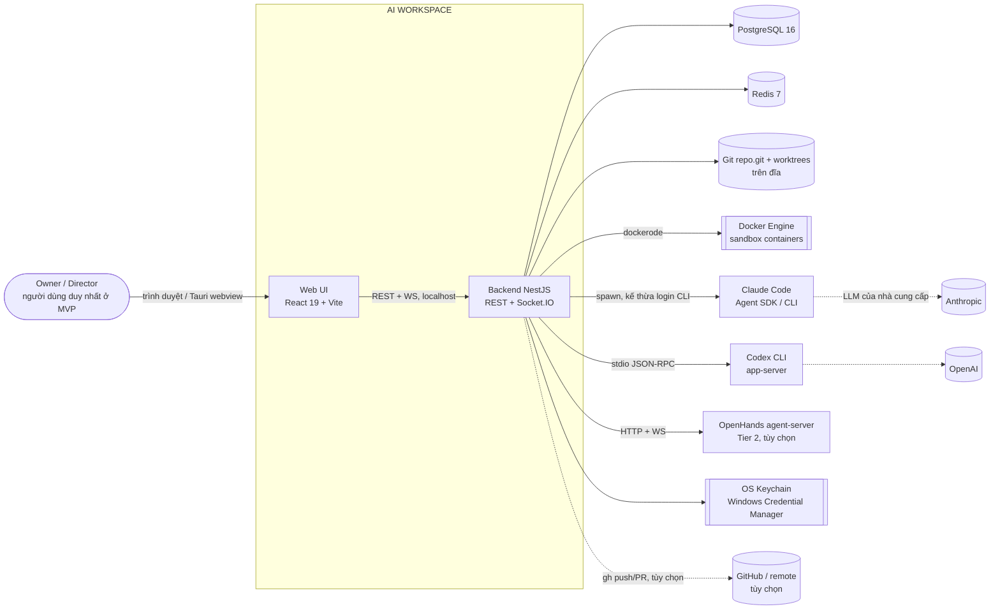
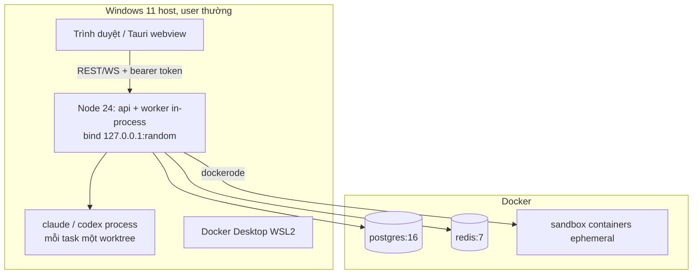
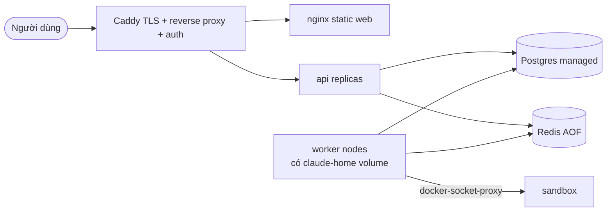

# SYSTEM_ARCHITECTURE — Kiến trúc hệ thống AI WORKSPACE

> Tác giả: System Architect · Phase 0 (chỉ tài liệu) · Trạng thái: Draft v0.1 · Ngày: 2026-10-30
> Nhãn: **[Đã xác minh]** = có trong tài liệu nguồn đã đọc (kèm đường dẫn); **[Đề xuất]** = quyết định của System Architect; **[Giả định]** = chưa có bằng chứng; **[Cần người dùng phê duyệt]** = cần Owner chốt.
> Mọi quyết định `D-xxx` lấy từ `DECISION_LOG.md`. **[OWR-2, 2026-10-30]** Trạng thái "Chờ duyệt" nói chung nay bị ghi đè từng quyết định bởi `PHASE_0_OWNER_DECISION_REGISTER.md` và `owner-responses/OWR-2_*.md` (ví dụ Q-16/D-001 React 19 + Vite APPROVED; D-003 định hướng duyệt, chưa khóa implementation tới khi PoC đạt; D-005 Codex và D-006 OpenHands **hoãn khỏi MVP**). Phase 0 vẫn mở; Phase 1 chưa được cho phép.
>
> **[OWR-3, 2026-10-30]** (A.8) **Claude là provider MVP duy nhất**; Codex hoãn, giữ `AgentAdapter`. (A.2/D) concurrency 5 là giới hạn scheduler nội bộ, không phải giới hạn provider cho phép. (A.10) **Xem conflict X-13** (`PHASE_0_OWNER_DECISION_REGISTER.md`, `DECISION_LOG.md` D-007): Agent không chạy arbitrary code trên Windows host; mọi code Agent sinh ra chạy trong sandbox cô lập, sandbox không hoạt động thì fail closed; Tier 2/OpenHands hoãn khỏi MVP; các câu hỏi mở của X-13 chưa được quyết tại đây, các mô tả "CLI trên host"/"Docker chỉ build/test/run" bên dưới là mô hình D-007 cũ đang chờ Owner làm rõ. (A.16) event dùng dotted lowercase (`EVENT_SYSTEM.md` §0).
> Tài liệu liên quan: `docs/BACKEND_ARCHITECTURE.md`, `docs/FRONTEND_ARCHITECTURE.md`, `docs/API_DOCUMENTATION.md`.

---

## 1. Mục đích

Mô tả bức tranh tổng thể của AI WORKSPACE: các thành phần (container/module), ranh giới giữa chúng, cách chúng triển khai ở chế độ desktop và web, đường đi dữ liệu của một task từ prompt đến bản preview, các lựa chọn công nghệ và lý do, cùng các mối quan tâm xuyên suốt (bảo mật, quan sát, lỗi, cấu hình). Tài liệu này là điểm neo để 3 tài liệu kiến trúc còn lại bám theo.

## 2. Phạm vi

- **Trong phạm vi:** kiến trúc logic và vật lý mức hệ thống; monorepo layout; topology runtime; data flow; technology choices; module boundaries; cross-cutting concerns.
- **Ngoài phạm vi:** chi tiết schema (xem `docs/DATABASE_DESIGN.md`), chi tiết threat model (xem `docs/SECURITY.md`), thiết kế màn hình (xem `docs/design/*`), mã nguồn (Phase 0 không viết mã ứng dụng).

## 3. Nội dung chi tiết

### 3.1 Context diagram (C4 mức 1)



- **[Đã xác minh]** Backend chạy native trên host (không trong container) vì phải spawn `claude`/`codex` bằng login của người dùng: `docs/architecture/INFRASTRUCTURE_DESIGN.md` §4.1.
- **[Đã xác minh]** App không đọc `.credentials.json` / `auth.json`; credential do CLI quản lý (D-008, `docs/SECURITY.md` §4).

### 3.2 Containers / modules mức cao

| Container | Vai trò | Công nghệ | Nguồn |
|---|---|---|---|
| `web` (SPA) | UI 22 màn hình, Virtual Office, Workflow Builder, Code Workspace | React 19, Vite, Tailwind v4, shadcn/ui | D-001, `docs/research/LICENSE_AND_REUSE.md` §5.4 |
| `api` (NestJS) | REST, WebSocket gateway, orchestration, scheduler, adapters | NestJS, Node 24 | D-001, INFRASTRUCTURE_DESIGN §4.1 |
| `worker` (cùng codebase `api`, entry riêng) | BullMQ processors: agent-runner, workflow-engine, sandbox, rollup | BullMQ | D-003, DATABASE_DESIGN §10 |
| `postgres` | Source of truth: 44 bảng, event store phân vùng theo tháng | PostgreSQL 16 + Drizzle | D-002 |
| `redis` | BullMQ, semaphore Lua, pub/sub, stream buffer, presence | Redis 7 | D-002, D-003, DATABASE_DESIGN §10 |
| Provider adapters | Chuẩn hóa provider về `AgentEvent` qua `AgentAdapter`; **MVP chỉ Claude** (Claude Agent SDK, OWR-2 Q-17); Codex (D-005) và OpenHands (D-006, sau Phase 4) **hoãn, chỉ giữ abstraction để mở rộng** | `@anthropic-ai/claude-agent-sdk`; (hoãn) `codex app-server` | D-004, D-005, D-006 |
| Sandbox executor | Chạy build/test/lint/preview trong Docker | dockerode | D-007, INFRASTRUCTURE_DESIGN §6 |
| `desktop` (giai đoạn sau) | Vỏ Tauri 2, backend làm sidecar | Tauri 2 | D-001 |

**[Đề xuất]** `api` và `worker` là **một codebase, hai entry point** (`main.ts`, `worker.ts`). Ở desktop mode chạy chung một process (in-process workers) để giảm số tiến trình; ở server mode tách được. Lý do: DATABASE_DESIGN §10 và ORCHESTRATION §2 đều giả định worker BullMQ riêng nhưng không bắt buộc tách tiến trình.

### 3.3 Monorepo layout (pnpm workspaces)

**[Đề xuất]**, dựa trên `docs/development/CI_CD.md` L20 (`apps/api`, `apps/web`, `apps/desktop`, `packages/*`, `infra/*`; pnpm 10 workspaces thuần; D-001 APPROVED, chưa dùng Turborepo) và `docs/DATABASE_DESIGN.md` §1.3.

```
ai-workspace/
├─ pnpm-workspace.yaml            # apps/*, packages/*
├─ (không turbo.json)             # D-001 APPROVED: pnpm thuần, Turborepo hoãn
├─ apps/
│  ├─ api/                        # @aiw/api   NestJS (+ worker entry)
│  │  └─ src/{modules/*, common/, database/ (schema, migrations, seeds), main.ts, worker.ts}
│  ├─ web/                        # @aiw/web   React SPA
│  └─ desktop/                    # @aiw/desktop  Tauri 2 (Phase sau, chưa tạo ở MVP)
├─ packages/
│  ├─ contracts/                  # @aiw/contracts  Zod DTO, event schema, error codes, OpenAPI source of truth
│  ├─ shared/                     # @aiw/shared     util thuần (id/ulid, result, time), không phụ thuộc framework
│  ├─ agent-core/                 # @aiw/agent-core AgentAdapter, AgentEvent, normalizers (không phụ thuộc NestJS)
│  ├─ workflow-schema/            # @aiw/workflow-schema  Workflow Definition (React Flow compatible) + validator
│  ├─ workspace/                  # @aiw/workspace  kiểu & logic Git/worktree/manifest dùng chung
│  ├─ codex-protocol/             # @aiw/codex-protocol  binding sinh bằng `codex app-server generate-ts`
│  ├─ office-engine/              # @aiw/office-engine  Phaser scene, BFS, FSM (không import React)
│  ├─ design-tokens/              # @aiw/design-tokens  token CSS/TS
│  └─ ui/                         # @aiw/ui         design system (shadcn-based) 
├─ infra/                         # docker-compose.dev.yml, sandbox images, otel
├─ e2e/                           # Playwright
└─ docs/
```

Ghi chú đối chiếu tên package với nguồn:
- `packages/agent-core` lấy từ `docs/research/CODEX_INTEGRATION.md` §11.2; `packages/workflow-schema` từ `ORCHESTRATION_WORKFLOW_RESEARCH.md` §3.1; `packages/workspace` từ `WORKSPACE_AND_GIT_ISOLATION.md` §12; `packages/codex-protocol` từ `CODEX_INTEGRATION.md` checklist; `packages/design-tokens`, `packages/ui`, `packages/shared` từ `docs/architecture/AGENT_ORGANIZATION.md` L64–66.
- **Mâu thuẫn tên:** `AGENT_ORGANIZATION.md` dùng `packages/adapters`, `prisma/**`, `contracts/**` (thư mục gốc); `CODEX_INTEGRATION.md` dùng `apps/backend/...`. Tài liệu này chọn `apps/api`, `packages/contracts`, adapter nằm trong `apps/api/src/modules/providers` + phần thuần trong `packages/agent-core`, Drizzle thay Prisma (theo D-002). Ownership glob trong `AGENT_ORGANIZATION.md` đã đổi sang `apps/api/src/database/**`, `drizzle/**` (D-002 APPROVED).
- Schema Drizzle nằm trong `apps/api/src/database/` theo DATABASE_DESIGN §1.3 (không tách `packages/db`) **[Đề xuất]**: chỉ `api`/`worker` truy cập DB, tránh FE import nhầm.

**Quy tắc phụ thuộc (enforce bằng eslint `no-restricted-imports` / dependency-cruiser):**

```mermaid
flowchart BT
  shared --> contracts
  contracts --> agent-core
  contracts --> workflow-schema
  contracts --> workspace
  agent-core --> api
  workflow-schema --> api
  workspace --> api
  codex-protocol --> api
  contracts --> web
  workflow-schema --> web
  office-engine --> web
  design-tokens --> ui --> web
  api -.x.-> web
```

`apps/web` không bao giờ import `apps/api`; `office-engine` không import React; `contracts` chỉ phụ thuộc `zod` và `shared`.

### 3.4 Runtime topology

**Desktop mode (MVP = web app + backend Node cục bộ, Tauri sau; D-001) [Đề xuất]:**



- **[Đã xác minh]** Bind `127.0.0.1` port ngẫu nhiên 49152–65535, bearer token 32 byte per-launch, Origin check, listener `/hooks/*` tách riêng: `docs/SECURITY.md` §7.
- **[Đã xác minh]** Dev dùng Docker Desktop cho Postgres/Redis, sandbox là container ephemeral: INFRASTRUCTURE_DESIGN §4.1, §5.
- **[Đề xuất]** `APP_MODE=desktop` seed org `local` + user `local@localhost`, auth middleware tự inject (DATABASE_DESIGN §8). Nếu bearer token per-launch được dùng ở desktop thì "không có login screen" vẫn đúng vì token do shell cấp.
- **[Cần người dùng phê duyệt]** Desktop có yêu cầu Docker Desktop hay bundle Postgres/Redis nhúng (DATABASE_DESIGN §12 mục 6).

**Web/server mode (staging/prod self-hosted) [Đề xuất, từ INFRASTRUCTURE_DESIGN §4.2–4.3]:**



Khác biệt chính: auth JWT/session + RLS (DATABASE_DESIGN §8), outbox đầy đủ, Socket.IO redis-adapter, CLI chạy trong container `worker`, Docker socket chỉ qua proxy hạn chế. Chưa có kế hoạch SaaS multi-tenant trong Phase 0 (INFRASTRUCTURE_DESIGN §4.3).

### 3.5 Data flow: một task từ prompt đến preview

```mermaid
sequenceDiagram
  participant O as Owner (web)
  participant A as API (REST)
  participant DB as Postgres
  participant Q as BullMQ/Redis
  participant C as Conductor (scheduler)
  participant R as AgentRunner + Adapter
  participant G as Workspace/Git
  participant S as Sandbox executor
  participant P as Approvals
  participant E as Outbox -> Socket.IO
  O->>A: POST /projects (prompt)
  A->>DB: tạo project, workflow_run (template SDLC) [tx + event + outbox]
  A->>Q: enqueue scheduler(runId)
  C->>DB: tính ready-set, chọn agent (PM scoring)
  C->>Q: acquire semaphore (global + provider) rồi enqueue node.agent
  R->>G: tạo worktree agent/<slug>/<task-id> + manifest + settings/hook
  R->>R: Adapter.startSession (Claude SDK / Codex app-server)
  R-->>DB: AgentEvent -> agent_events + usage_records
  R->>P: canUseTool / hook -> approval nếu ask-list
  P-->>O: HUMAN_APPROVAL_REQUESTED (WS)
  O->>A: POST /approvals/:id/decision
  A->>DB: node_run WAITING_HUMAN -> tiếp tục; kích scheduler
  R->>G: commit; diff validation theo manifest
  C->>S: job build/test/lint (Docker, network none)
  C->>G: merge task -> integration/<project>
  C->>S: deploy preview (không production)
  E-->>O: events realtime (office + dashboard)
  O->>A: GET /projects/:id/preview, nghiệm thu approve/reject
```

Các điểm đã xác minh trong nguồn:
- Prompt khởi chạy template SDLC 8 giai đoạn, human approval sau BA và UI/UX, preview không auto deploy production: `docs/product/PRD.md` §5.5.
- `tick(run)` → ready-set → semaphore → enqueue; approval = `WAITING_HUMAN` không giữ worker: `ORCHESTRATION_WORKFLOW_RESEARCH.md` §0, §2.
- Worktree/branch/manifest, kiểm diff sau cùng, luồng `task → integration → main` không tự merge main: D-009, `WORKSPACE_AND_GIT_ISOLATION.md` §5–8.
- Hook giữ HTTP chờ quyết định (timeout app 540 s), `input_hash` chống TOCTOU: `SECURITY.md` §5.3.
- Reject tạo revision task có mục tiêu, không chạy lại toàn bộ: `ORCHESTRATION_WORKFLOW_RESEARCH.md` §8.

### 3.6 Module boundaries (backend, tóm tắt; chi tiết ở BACKEND_ARCHITECTURE)

| Bounded context | Module | Được phép gọi | Không được |
|---|---|---|---|
| Identity & Tenancy | auth, organizations | database | gọi provider, orchestrator |
| Organization | departments, agents, skills | identity, events | tự spawn process |
| Provider | providers (adapters) | agent-core, keychain (chỉ ref) | đọc token CLI |
| Execution | sessions, orchestrator, scheduler, sandbox | providers, workspace, approvals, events | ghi trực tiếp vào bảng của module khác (đi qua service/event) |
| Governance | approvals, audit, usage | events | bỏ qua append-only |
| Realtime | events/outbox, gateways, office projector | Redis | đọc DB nghiệp vụ trực tiếp ngoài projector |

Quy tắc: module chỉ truy cập bảng do mình sở hữu; truy cập chéo qua service export hoặc domain event. **[Đề xuất]**.

### 3.7 Technology choices

| Lớp | Chọn | Lý do | Nhãn / Nguồn |
|---|---|---|---|
| Ngôn ngữ | TypeScript toàn stack | Chia sẻ `contracts`, một toolchain | D-001 |
| Backend | NestJS | DI, module, gateway, guard/interceptor phù hợp bounded context | D-001 |
| Frontend | React 19.2, Vite 7, Tailwind 4.1, shadcn/ui | Phaser/Monaco/React Flow đều có tích hợp tốt; Next.js không cần SSR | D-001, LICENSE_AND_REUSE §5.4 |
| DB | PostgreSQL 16 | event store partition, JSONB, partial unique index | D-002, DATABASE_DESIGN §0 |
| ORM | Drizzle (postgres.js) | partial index, transaction savepoint, không binary engine trên đường có khoảng trắng | D-002, DATABASE_DESIGN §1.2 |
| Queue/cache | Redis 7 + BullMQ | transport, retry, stalled detection; semaphore Lua | D-003 |
| Workflow | "Conductor" tự xây | DAG user-editable, WAITING_HUMAN durable; loại LangGraph/Temporal | D-003, ORCHESTRATION §2.2 |
| Provider | Claude Agent SDK (MVP); Codex app-server và OpenHands agent-server **hoãn khỏi MVP** (OWR-2 D-005/D-006, Q-02) | D-004/005/006 | |
| Realtime | Socket.IO 4 | rooms theo project/agent/run, reconnect, ack lệnh điều khiển | D-014, LICENSE_AND_REUSE §5.4 |
| Office | Phaser 3.90 | D-011 | |
| Workflow UI | `@xyflow/react` 12 | LICENSE_AND_REUSE §5.2 (cần attribution badge hoặc Pro) | **[Đã xác minh]** |
| State FE | Zustand 5 + TanStack Query 5 | LICENSE_AND_REUSE §5.4 | |
| Validation | Zod trong `contracts` | DATABASE_DESIGN §0, §5.1 dùng Zod cho JSONB/event payload | **[Đề xuất]** dùng Zod cả cho DTO |
| Logging | pino (nestjs-pino) | **[Đề xuất]** | |
| Desktop | Tauri 2 sidecar (sau) | D-001 | |

### 3.8 Cross-cutting concerns

1. **Bảo mật:** localhost-only + bearer token, Origin check, rate limit 100 req/10 s, redaction middleware, approval policy engine, audit append-only (`docs/SECURITY.md` §4, §5, §7, §8). Sandbox hai tầng (D-007) là "lớp chính sách, không phải ranh giới bảo mật" cho CLI trên host (**[OWR-3 A.10: xem conflict X-13]**).
2. **Multi-tenancy:** `organization_id` mọi bảng business; `TenantContext` (AsyncLocalStorage); RLS là hàng rào phụ ở server mode (DATABASE_DESIGN §8).
3. **Event-driven:** mọi thay đổi trạng thái phát domain event trong cùng transaction với outbox (D-014). Event là nguồn duy nhất cho UI và Virtual Office (PRD §5.5).
4. **Idempotency & recovery:** `jobId = runId`, `(provider_id, request_id)` unique, `aiw:idemp:{requestId}` TTL 24h, stale-run recovery bởi `presence-reaper` (DATABASE_DESIGN §10, ORCHESTRATION §4.4).
5. **Quan sát:** pino JSON log có `correlationId`; `agent_events` mang `correlation_id`/`causation_id`; metrics/otel tùy chọn (INFRASTRUCTURE_DESIGN §8).
6. **Cấu hình:** biến môi trường validate bằng Zod lúc boot; secret chỉ là `credential_ref` tới keychain (DATABASE_DESIGN §8).
7. **Lỗi:** một error envelope duy nhất (xem `API_DOCUMENTATION.md` §3.2).
8. **Chi phí & giới hạn:** budget check trước mỗi request từ Redis counter; concurrency mặc định 5, tối đa 18 (D-010; **[OWR-3 A.2/D]** giới hạn scheduler nội bộ, không phải giới hạn provider bảo đảm).
9. **i18n & thời gian:** UTC `timestamptz`, ID uuid v7 (DATABASE_DESIGN §0), UI mặc định **tiếng Việt**, tiếng Anh là locale thứ hai (D-015; OWR-3 X-1; thay thế câu "mặc định tiếng Anh" trước đây).
10. **Giấy phép:** tuân D-012; không sao chép mã My Virtual Office (AGPL).

## 4. Quyết định & lý do

| # | Quyết định | Lý do | Nhãn |
|---|---|---|---|
| S-1 | Một codebase `api`, hai entry (api/worker) | Giảm tiến trình ở desktop, vẫn scale được ở server | [Đề xuất] |
| S-2 | Schema Drizzle nằm trong `apps/api`, không tách package | Chỉ backend được chạm DB | [Đề xuất] |
| S-3 | `packages/contracts` là nguồn duy nhất cho DTO/event/error; FE và BE import chung | Parallel development (xem API_DOCUMENTATION §10) | [Đề xuất] |
| S-4 | `office-engine` tách khỏi React | Phaser test được riêng, ranh giới rõ (D-011) | [Đề xuất] |
| S-5 | Backend native trên host ở dev/desktop | Cần login CLI của user | [Đã xác minh] INFRASTRUCTURE_DESIGN §4.1 |
| S-6 | Postgres là source of truth; Redis chỉ trạng thái tạm | Phục hồi sau crash | [Đã xác minh] AGENT_SCHEDULER §3 |
| S-7 | pnpm 10 workspaces thuần (Turborepo hoãn) | Ít công cụ ở Phase 1 | D-001 APPROVED (2026-10-30) |

## 5. Dependencies

- Tài liệu: `DECISION_LOG.md` (D-001..D-016), `docs/DATABASE_DESIGN.md`, `docs/SECURITY.md`, `docs/architecture/*`, `docs/research/*`.
- Phần mềm: Node 24, pnpm 10, Docker Desktop (Windows 11), PostgreSQL 16, Redis 7, Claude Code CLI (đã cài, 2.1.312), Codex CLI (**chưa cài** theo `docs/research/CODEX_INTEGRATION.md` §0 và `DECISION_LOG.md` mục 4).
- Quyết định chờ duyệt: toàn bộ D-001..D-016.

## 6. Rủi ro

| Rủi ro | Tác động | Giảm thiểu |
|---|---|---|
| CLI chạy trên host mâu thuẫn yêu cầu "không chạy code AI trên host" | Vi phạm yêu cầu gốc | D-007 hai tầng (APPROVED có điều kiện, Owner 2026-10-30; CF-043): fail-closed khi Docker tắt; SB-00..SB-17 qua trước khi mở quyền thực thi; Owner chấp nhận rủi ro ghi overlay ở Phase 0-1, giảm bằng checksum và audit; xác nhận R1, R2, R3, R5, R6 theo Q-01 (`SECURITY.md` §10) |
| Quota subscription giới hạn song song | 18 agent không khả thi | Mặc định 5, nâng theo bằng chứng (D-010) |
| Docker daemon chưa xác minh cgroup/ECI/rootless | Sandbox có thể yếu | Kiểm thử trong Phase 1 |
| Codex chưa cài, chưa test thực | Adapter Codex rủi ro | Dựng contract test với fixture; fallback `codex exec --json` |
| Trôi lệch tên package/đường dẫn giữa các tài liệu | Agent ghi sai thư mục (ownership glob) | Chốt §3.3 trước Phase 1 |
| Hai tiến trình Node trong một desktop làm phức tạp | Khó debug | Mặc định in-process worker |
| React Flow yêu cầu attribution | Vấn đề giấy phép nhỏ | Giữ badge hoặc mua Pro |

## 7. Vấn đề chưa giải quyết

1. ĐÃ CHỐT (D-001): không dùng Turborepo ở Phase 1.
2. Desktop có bắt buộc Docker Desktop hay bundle Postgres/Redis nhúng?
3. Bearer token per-launch (SECURITY §7) và "desktop không màn hình login" (DATABASE_DESIGN §8) cần thống nhất cách shell cấp token ở chế độ trình duyệt thuần (MVP chưa có Tauri).
4. Publish-after-commit (desktop) hay outbox đầy đủ (server)? Đề xuất của tài liệu này: **outbox đầy đủ cho cả hai** để một code path (xem BACKEND §8) **[Cần người dùng phê duyệt]**.
5. Một office toàn cục hay một office mỗi project (NAVIGATION_STRUCTURE §16 mục 5).
6. Điều khoản dịch vụ cho nhiều phiên song song (DECISION_LOG mục 2).

## 8. Mâu thuẫn giữa các tài liệu nguồn (đã phát hiện)

| # | Mâu thuẫn | Vị trí | Xử lý đề xuất |
|---|---|---|---|
| 1 | Prisma vs Drizzle | ORCHESTRATION §3.2 (Prisma schema), AGENT_ORGANIZATION L66–67 (`prisma/**`) vs D-002/DATABASE_DESIGN (Drizzle) | Theo D-002 (APPROVED, 2026-10-30); coi Prisma schema trong ORCHESTRATION chỉ là minh họa |
| 2 | Concurrency mặc định | ORCHESTRATION §0 "semaphore global 10" vs D-010 (mặc định 5, tối đa 18) | Theo D-010 |
| 3 | Tên event | ORCHESTRATION §7 UPPERCASE (`AGENT_CREATED`) vs DATABASE_DESIGN §5.2 dotted lowercase (`session.started`) vs NAVIGATION §10 category dạng `approval.requested` | Chốt: `type` dotted lowercase trong `agent_events`; map 1-1 sang tên UPPERCASE chỉ ở lớp hiển thị/tài liệu (xem API_DOCUMENTATION §6.3) |
| 4 | Kênh Redis | ORCHESTRATION §7.3 `ws:workspace:<id>` vs DATABASE_DESIGN §10 `aiw:ch:*` | Theo DATABASE_DESIGN (có prefix) |
| 5 | `workspaceId` vs `organization_id` | ORCHESTRATION §7.1 vs DATABASE_DESIGN | Dùng `organizationId` |
| 6 | Tên thư mục backend | `apps/backend` (CODEX_INTEGRATION) vs `apps/api` (CI_CD, DATABASE_DESIGN) | `apps/api` |
| 7 | Trạng thái agent | PRD 12 lifecycle states vs event `idle|working|waiting|error|offline` | Giữ 12 trạng thái làm enum `agent_status`; event status là phép chiếu (cần A08 xác nhận) |
| 8 | Case enum `task_status` | DECISION_LOG mục 5, DATABASE_DESIGN §12 | Chờ Owner |
| 9 | Auth: JWT/session (DATABASE_DESIGN §8) vs bearer per-launch (SECURITY §7) | Hai chế độ khác nhau | Desktop = bearer, server = JWT (xem BACKEND §3.1) |

## 9. Acceptance Criteria

- [ ] Context diagram và sequence diagram render được bằng Mermaid.
- [ ] Mọi package trong §3.3 có Owner module và quy tắc phụ thuộc kiểm tra được bằng lint.
- [ ] Mỗi quyết định công nghệ trong §3.7 dẫn tới một D-xxx hoặc ghi rõ [Đề xuất].
- [ ] Mâu thuẫn §8 được Owner chốt hoặc ghi `DECISION_LOG.md`.
- [ ] Phase 1 dựng được skeleton monorepo (`pnpm install`, `pnpm -r build`) theo §3.3 mà không đổi tên package.
- [ ] Không chứa claim "Đã xác minh" thiếu nguồn.
